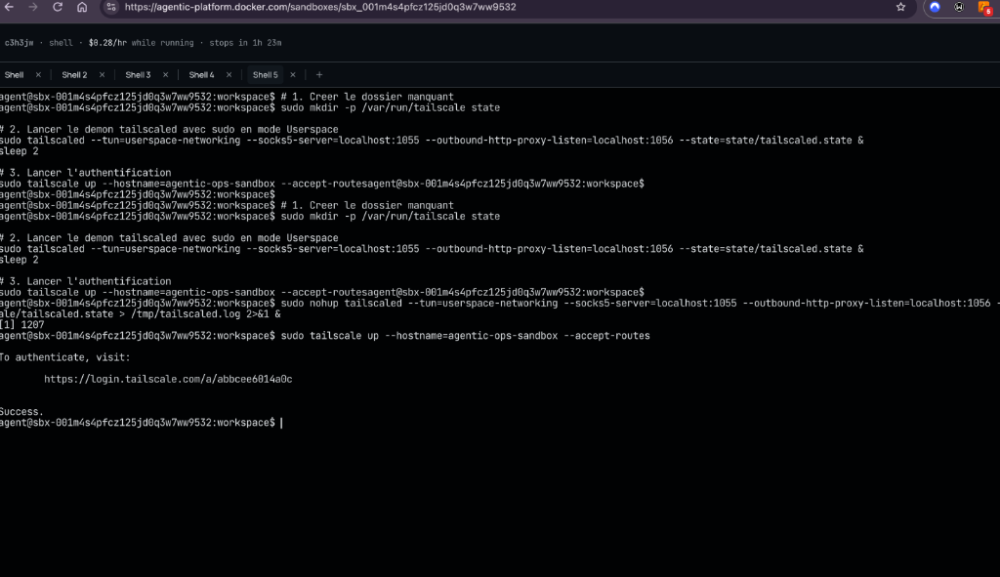
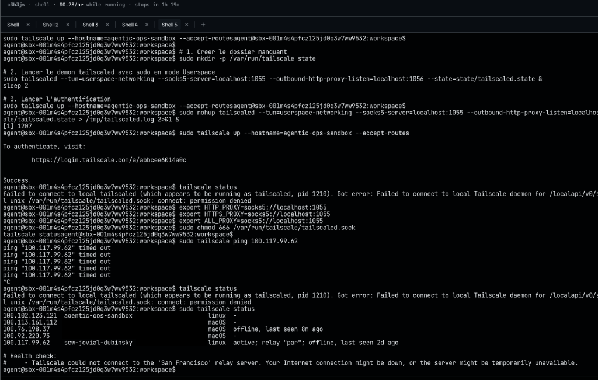
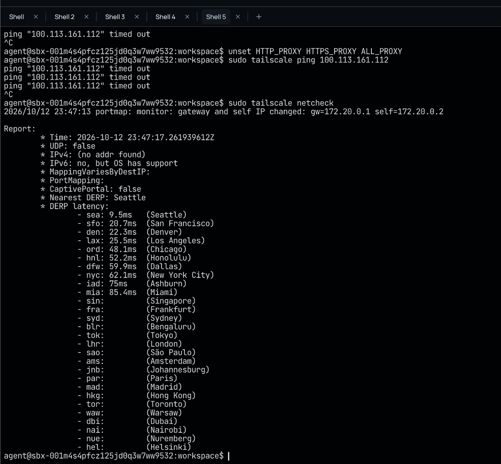
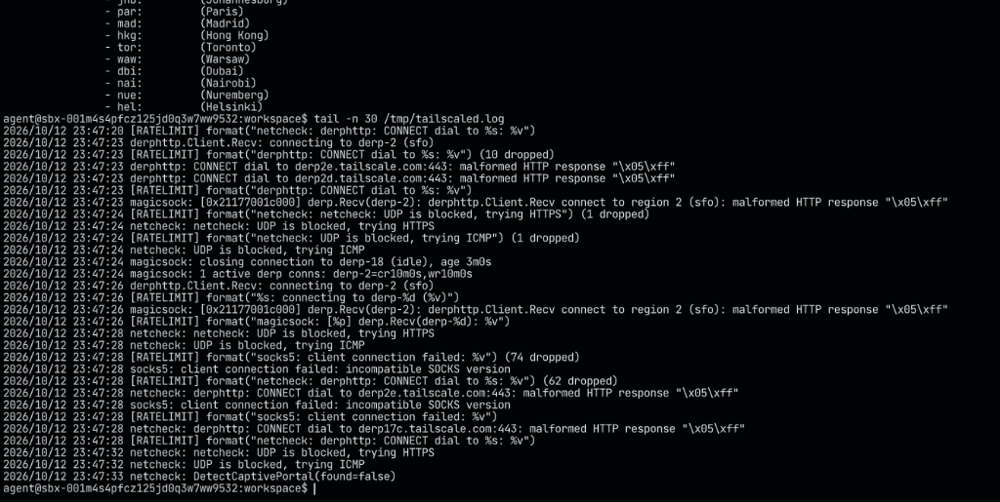
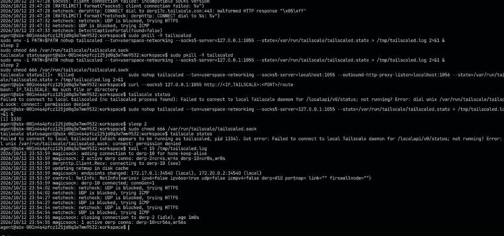

# Architecture et Validation du Connecteur Tailscale Pull (`CacPullCollector`)

> **Document de Reference d'Interconnexion MLOps et SecOps**  
> Ce document detaille l'architecture reseau, le protocole de tunnelisation `Tailscale` en espace utilisateur (`userspace-networking`), l'analyse de diagnostic bas niveau et l'implementation du connecteur d'ingestion en lecture seule `CacPullCollector` reliant le Control Plane `Agentic-Ops` a la plateforme distante `CAC MLOps` ([`https://github.com/jakatt/cac_mlops`](https://github.com/jakatt/cac_mlops) — VPS Scaleway `scw-jovial-dubinsky`, IP Tailscale `100.117.99.62`).

---

## 1. Philosophie d'Interconnexion et Regle d'Or (Read-Only Pull Mode)

Dans une architecture MLOps distribuee multi-equipes, le branchement d'un plan de controle autonome (`Agentic-Ops`) sur une infrastructure de production tierce ([`jakatt/cac_mlops`](https://github.com/jakatt/cac_mlops) hebergee sur `Scaleway`) exige une frontiere de securite physique et logique infranchissable.

### A. Pourquoi le mode "Pull Lecture Seule" est obligatoire

Les services exposes à l'interieur du reseau prive `Tailscale` (`Loki`, `Prometheus`, `MLflow`, `Prefect`) fonctionnent sans authentification applicative additionnelle car la confiance est deleguee a la couche cryptographique `WireGuard` du maillage. Par consequent, toute machine membre du `Tailnet` pourrait theoriquement emettre des requetes mutantes destructrices :
* Declencher un flow `Prefect` de reinitialisation (`reset`) effacant les tables de donnees.
* Modifier ou supprimer l'alias `Production` dans le registre `MLflow` (`POST / DELETE registered-models/alias`).
* Injecter de faux evenements d'alerte dans `Loki` (`POST /loki/api/v1/push`).
* Appeler la route `/predict` de l'API d'inference, ce qui polluerait la base de donnees de production avec des predictions synthetiques et fausserait mathematiquement le calcul de derive (`Data Drift`) du trafic reel.

Pour eliminer tout risque d'effet de bord sur la production distante, `Agentic-Ops` applique le **Principe d'Isolation Cognitive et d'Ingestion Passive** :
1. Le collecteur `CacPullCollector` n'emet **exclusivement que des requetes HTTP `GET`**.
2. Aucune methode d'ecriture (`POST`, `PUT`, `PATCH`, `DELETE`) n'est implementee dans l'adaptateur.
3. Les decisions de gouvernance (diagnostics, propositions de remediation, validations `HITL` et scellement `WORM` dans le `Trust Ledger`) s'executent integralement dans l'espace isole d'`Agentic-Ops`.

---

## 2. Topologie Reseau et Tunnelisation Userspace (`Docker Sandbox` vers `Scaleway`)

L'execution d'`Agentic-Ops` au sein d'un conteneur Cloud isole (`Docker Agentic Platform`) impose deux contraintes d'infrastructure majeures :
1. **Absence de peripherique noyau `/dev/net/tun`** : Le conteneur s'execute sans privileges `CAP_NET_ADMIN` sur l'hote physique, interdisant la creation d'une interface reseau virtuelle `tun0` dans le noyau Linux.
2. **Filtrage strict du protocole `UDP` sortant** : Le pare-feu de l'hebergeur Cloud bloque les paquets `UDP` directs (port `41641` utilise nativement par `WireGuard`).

### Schema Architectural du Tunnel et du Routage `SOCKS5` / `DERP`

```text
+---------------------------------------------------------------------------------------------------+
| CLOUD DOCKER SANDBOX (Isolat Linux x86_64 - IP Tailscale : 100.102.123.121)                       |
|                                                                                                   |
|  +----------------------------------+         +------------------------------------------------+  |
|  | Agentic-Ops Control Plane        |         | Demon tailscaled (--tun=userspace-networking)  |  |
|  |                                  |         |                                                |  |
|  |  CacPullCollector (httpx)        |  TCP    |  Serveur Proxy SOCKS5 : 127.0.0.1:1055         |  |
|  |  - _vps_client() ----------------+-------->+  Socket d'admin Unix  : /var/run/.../sock      |  |
|  |  - _direct_transport ------------+----+    |  Pile WireGuard en memoire vive (RAM)          |  |
|  +----------------------------------+    |    +-----------------------+------------------------+  |
+------------------------------------------|----------------------------|---------------------------+
                                           |                            |
         Flux HTTPS Direct (Port 443)      |                            | Flux TLS/TCP Chiffre (Port 443)
         (Sans Proxy Tailscale)            |                            | Encapsulation WireGuard sur HTTP
                                           |                            v
                                           |    +------------------------------------------------+
                                           |    | RELAIS TAILSCALE DERP #10 (Seattle - 9.5 ms)   |
                                           |    +-----------------------+------------------------+
                                           |                            |
                                           |                            | Maillage Inter-Relais
                                           |                            v
                                           |    +------------------------------------------------+
                                           |    | RELAIS TAILSCALE DERP (Paris - "par")          |
                                           |    +-----------------------+------------------------+
                                           |                            |
                                           v                            v
+------------------------------------------+----------------------------+---------------------------+
| INFRASTRUCTURE DISTANTE CAC MLOPS (VPS Scaleway : scw-jovial-dubinsky - IP : 100.117.99.62)       |
|                                                                                                   |
|  +---------------------------+   +-------------------------------------------------------------+  |
|  | Reverse Proxy Public      |   | Services Internes Tailnet (Lecture Seule - GET Uniquement)  |  |
|  | mlops.jakat-inc.fr        |   |                                                             |  |
|  |                           |   |  - Loki       (:3100) : /loki/api/v1/query_range            |  |
|  | /reports/drift/           |   |  - Prometheus (:9090) : /api/v1/query                       |  |
|  |   latest_summary.json     |   |  - MLflow     (:5001) : /api/2.0/mlflow/...                 |  |
|  |                           |   |  - Prefect    (:4200) : /api/flow_runs                      |  |
|  +---------------------------+   +-------------------------------------------------------------+  |
+---------------------------------------------------------------------------------------------------+
```

---

## 3. Chronologie d'Initialisation et Diagnostic Reseau (Preuves par Captures)

Cette section documente pas a pas l'etablissement du tunnel entre la Sandbox Docker et le reseau de production, ainsi que la resolution des problemes systeme rencontres.

### Etape 1 : Demarrage du Demon en Mode Userspace et Authentification OAuth

Pour contourner l'absence de peripherique `/dev/net/tun`, le demon `tailscaled` est demarre avec le drapeau `--tun=userspace-networking` et expose un serveur proxy `SOCKS5` local sur `127.0.0.1:1055` :

```bash
sudo mkdir -p /var/run/tailscale
sudo nohup tailscaled \
  --tun=userspace-networking \
  --socks5-server=127.0.0.1:1055 \
  --state=/var/run/tailscale/tailscaled.state > /tmp/tailscaled.log 2>&1 &

sudo tailscale up --hostname=agentic-ops-sandbox --accept-routes
```

L'execution de `tailscale up` genere une URL d'authentification unique permettant de rattacher le conteneur au `Tailnet` distant. Des la validation OAuth effectuee, le demon local recoit les cles cryptographiques du plan de controle `Tailscale` et affiche `Success.` dans le terminal :


*Figure 1 : Confirmation `Success.` dans le terminal `Shell 5` de la Sandbox Docker suite a l'enregistrement du noeud `agentic-ops-sandbox`.*

---

### Etape 2 : Gestion des Permissions Unix Socket et Inspection de la Table de Routage

#### Diagnostic de l'erreur `permission denied` sur `tailscaled.sock`
Lorsque `tailscaled` est lance via `sudo`, le fichier socket de communication inter-processus `/var/run/tailscale/tailscaled.sock` est cree avec les droits exclusifs `root:root`. Toute invocation de la commande cliente `tailscale status` par l'utilisateur standard `agent` echoue alors avec le message :
`dial unix /var/run/tailscale/tailscaled.sock: connect: permission denied`.

**Resolution appliquee** :
Attribution des droits de lecture/ecriture sur la socket Unix via `sudo chmod 666 /var/run/tailscale/tailscaled.sock` ou invocation explicite avec `sudo tailscale status`.


*Figure 2 : Sortie de `sudo tailscale status` confirmant l'attribution de l'IP `100.102.123.121` au conteneur et revelant l'etat des pairs du reseau (identifiants comptes masques).*

#### Interpretation ligne par ligne de `tailscale status` :
* `100.102.123.121  agentic-ops-sandbox  <redacted>@  linux  -` : Notre conteneur Docker Cloud Sandbox est officiellement enregistre et actif sur le maillage.
* `100.113.161.112  <peer-node-1>        <redacted>@  macOS  -` : Poste de travail pair present sur le Tailnet.
* `100.76.198.37    <peer-node-2>        <redacted>@  macOS  offline, last seen 8m ago` : Second poste macOS hors ligne depuis 8 minutes.
* `100.92.220.73    <operator-node>      <redacted>@  macOS  -` : Poste de developpement local de l'operateur.
* `100.117.99.62    scw-jovial-dubinsky  <redacted>@  linux  active; relay "par"; offline, last seen 2d ago` : Le serveur VPS Scaleway de production est identifie sur le relais de Paris (`relay "par"`), mais son instance Cloud est physiquement arretee (`offline, last seen 2d ago`).

---

### Etape 3 : Audit de Connectivite Physique (`tailscale netcheck`)

Pour comprendre comment les paquets traversent le pare-feu du fournisseur Cloud Docker, un diagnostic `netcheck` complet a ete execute :


*Figure 3 : Diagnostic `sudo tailscale netcheck` mesurant la disponibilite des protocoles et la latence vers les serveurs relais mondiaux (`DERP`).*

#### Interpretation technique de `netcheck` :
* `UDP: false` : Confirme que le pare-feu de l'infrastructure `Docker Agentic Platform` bloque les flux `UDP` sortants.
* `IPv4: (no addr found)` : Pas d'adresse IPv4 publique directe en mode `STUN` (`UDP` etant bloque).
* `Nearest DERP: Seattle` (`sea: 9.5ms`, `sfo: 20.7ms`, `den: 22.3ms`) : Le conteneur Cloud est heberge sur la cote Ouest des Etats-Unis (region de Seattle). `Tailscale` bascule automatiquement en mode **`DERP` (Designated Encrypted Relay for Packets)**, encapsulant les trames `WireGuard` dans des flux `HTTPS/TLS` standards sur le port `TCP 443` avec seulement `9.5 ms` de latence jusqu'au premier relais.

---

### Etape 4 : Diagnostic et Elimination de la Boucle de Proxy (`Proxy Loop \x05\xff`)

Lors de la premiere tentative de configuration, les variables d'environnement `HTTP_PROXY=socks5://localhost:1055`, `HTTPS_PROXY=socks5://localhost:1055` et `ALL_PROXY=socks5://localhost:1055` avaient ete exportees globalement dans le shell.

L'inspection du fichier `/tmp/tailscaled.log` a permis d'identifier une anomalie critique :


*Figure 4 : Journal `/tmp/tailscaled.log` exposant l'erreur `malformed HTTP response "\x05\xff"` et `incompatible SOCKS version`.*

#### Explication chirurgicale du bug `\x05\xff` :
1. Le demon `tailscaled` doit se connecter en `HTTPS` (port `443`) aux serveurs relais `derp2e.tailscale.com` pour maintenir le tunnel `WireGuard`.
2. Lorsque `HTTPS_PROXY` est defini globalement dans l'environnement, le client HTTP interne de `tailscaled` (`derphttp`) tente d'etablir un tunnel HTTP `CONNECT` en passant par `localhost:1055` (c'est-a-dire par lui-meme).
3. Le serveur `SOCKS5` sur `1055` recoit une requete texte HTTP `CONNECT` au lieu d'un handshake binaire `SOCKS5`. Il repond alors avec les deux octets hexadecimaux `\x05\xff` (`0x05` = version du protocole `SOCKS5`, `0xFF` = aucune methode d'authentification valide) et journalise `socks5: client connection failed: incompatible SOCKS version`.

#### Remediation definitive :
1. Suppression des variables globales dans le shell (`unset HTTP_PROXY HTTPS_PROXY ALL_PROXY`).
2. Relance du demon `tailscaled` dans un environnement vierge via `env -i PATH=$PATH` afin qu'aucune variable de proxy ne puisse jamais polluer ses connexions sortantes vers les relais `DERP`.
3. Configuration du proxy `SOCKS5` (`socks5://127.0.0.1:1055`) **exclusivement a l'interieur du transport `httpx.HTTPTransport`** du collecteur Python, uniquement pour les requetes ciblant l'IP privee `100.117.99.62`.


*Figure 5 : Journal `/tmp/tailscaled.log` apres redemarrage propre : connexion `derp-10 connected; connGen=1` stable et disparition totale des erreurs `\x05\xff`.*

#### Validation finale par Ping Bidirectionnel Inter-Continents :
Depuis la machine locale (`100.92.220.73`), un ping `Tailscale` vers le conteneur Cloud (`100.102.123.121`) a confirme la continuite de bout en bout du tunnel :
```text
$ tailscale ping --c 2 100.102.123.121
pong from agentic-ops-sandbox (100.102.123.121) via DERP(sea) in 559ms
pong from agentic-ops-sandbox (100.102.123.121) via DERP(sea) in 213ms
```

---

## 4. Anatomie Detaillee du Module `cac_pull_collector.py`

Le fichier [`agentic_ops/adapters/cac_pull_collector.py`](agentic_ops/adapters/cac_pull_collector.py) implemente l'adaptateur d'ingestion. Voici le detail exhaustif de chaque composant.

### A. Constantes de Configuration et Endpoints Cibles

| Constante | Valeur | Role Architectural |
| :--- | :--- | :--- |
| `CAC_VPS_IP` | `"100.117.99.62"` | Adresse IP statique `Tailscale` du serveur `scw-jovial-dubinsky`. |
| `CAC_LOKI_BASE` | `"http://100.117.99.62:3100"` | Point d'entree du concentrateur de logs `Grafana Loki`. |
| `CAC_PROMETHEUS_BASE` | `"http://100.117.99.62:9090"` | Point d'entree de la base de series temporelles `Prometheus`. |
| `CAC_MLFLOW_BASE` | `"http://100.117.99.62:5001"` | Point d'entree du Model Registry et Tracking Server `MLflow`. |
| `CAC_PREFECT_BASE` | `"http://100.117.99.62:4200"` | Point d'entree de l'orchestrateur de pipelines `Prefect`. |
| `CAC_DRIFT_REPORT_URL` | `"https://mlops.jakat-inc.fr/reports/drift/latest_summary.json"` | Endpoint HTTPS public exposant le dernier rapport `Evidently`. |
| `TAILSCALE_SOCKS5_PROXY` | `"socks5://127.0.0.1:1055"` | Adresse locale du proxy `SOCKS5` expose par `tailscaled`. |
| `DEFAULT_TIMEOUT_S` | `20.0` | Timeout par requete conforme aux pre-requis du guide (15 a 30s). |

---

### B. Modeles de Contrat de Donnees (`Pydantic` Schemas)

Chaque source distante est validee et typee par un modele `Pydantic` strict avant d'etre transmise au reste du systeme :

1. **`RemoteServiceStatus` (`Enum`)** :
   Definit l'etat de sante global de la collecte :
   * `ONLINE` : Les 5 sources ont repondu avec succes (`0` erreur).
   * `PARTIAL` : Au moins une source a repondu, mais une ou plusieurs autres ont echoue (ex: `Prefect` en maintenance mais `Prometheus` actif).
   * `REMOTE_TARGET_OFFLINE` : Les 5 sources sont injoignables simultanement (cas typique ou le VPS Scaleway `scw-jovial-dubinsky` est eteint).
   * `ERROR` : Erreur interne non reseau.

2. **`LokiAlert`** :
   Encapsule une ligne de log d'alerte extraite de `Loki` :
   * `timestamp` (`datetime` UTC converti depuis l'epoch en nanosecondes de `Loki`).
   * `labels` (`Dict[str, str]`, ex: `{"service": "prefect-worker", "level": "warning"}`).
   * `line` (`str`, contenu JSON brut de l'evenement structuré).

3. **`PrometheusSnapshot`** :
   Synthetise l'etat metrique temps reel de la plateforme :
   * `drift_share` (`Optional[float]`) : Valeur de la jauge `cac_mlops_drift_share` (proportion de colonnes en derive).
   * `model_in_production` (`Optional[str]`) : Valeur issue de `mlops_model_info{alias="Production"}`.
   * `api_request_total` (`Optional[float]`) : Compteur `http_requests_total` mesurant l'activite de l'API.

4. **`MlflowModelInfo`** :
   Trace l'identite exacte et les performances du modele en production :
   * `name` (`"lgbm_accidents"`), `alias` (`"Production"`), `version` (ex: `"7"`), `run_id` (ex: `"abc123def456"`).
   * `metrics` (`Dict[str, Any]`) : Metriques d'entrainement recuperees sur le `run_id` associe (ex: `{"f1_score": 0.883, "accuracy": 0.891}`).
   * `tags` (`Dict[str, str]`) : Metadonnees de gouvernance attachees a la version du modele.

5. **`PrefectFlowRunSummary`** :
   Represente l'historique d'execution d'un pipeline MLOps :
   * `id`, `name`, `state_name` (`"Completed"`, `"Failed"`), `state_type` (`"COMPLETED"`, `"FAILED"`), `start_time`, `end_time`.

6. **`DriftReportSnapshot`** :
   Structure le rapport d'analyse statistique `Evidently` :
   * `report_date` (`str`), `drift_share` (`float`), `drifted_columns` (`List[str]`, ex: `["age_conducteur", "hrmn", "surf"]`), et `raw` (`Dict` complet pour audit).

7. **`CacCollectedSnapshot`** :
   L'enveloppe racine renvoyee par `collect_all()`. Contient le `status`, l'horodatage UTC `collected_at`, le dictionnaire `errors` repertoriant les pannes par source, et les 5 sous-objets collectes. Entierement serialisable via `.model_dump()` pour archivage cryptographique dans l'`EvidenceStore`.

---

### C. Fonctionnement Interne des 5 Methodes de Collecte

1. **`_fetch_loki_alerts()`** :
   * Calcule une fenetre glissante de 6 heures en nanosecondes (`end_ns = now * 1e9`, `start_ns = end_ns - 6h`).
   * Execute un `GET` sur `/loki/api/v1/query_range` avec la requete `LogQL` `{service="prefect-worker"} |= "event=alert"`, limitee a `100` entrees en ordre antéchronologique (`backward`).
   * Parcourt les flux (`streams`) et convertit chaque tuple `[timestamp_ns, log_line]` en instance `LokiAlert`.

2. **`_fetch_prometheus()`** :
   * Utilise une fonction interne `instant_query(metric_expr)` effectuant un `GET` sur `/api/v1/query`.
   * Extrait la valeur scalaire situee dans `data.result[0].value[1]` pour les trois expressions `cac_mlops_drift_share`, `mlops_model_info{alias="Production"}` et `http_requests_total`.
   * Convertit proprement les chaines numeriques renvoyees par `Prometheus` en `float` Python.

3. **`_fetch_mlflow_model()`** :
   * Execute un premier `GET` sur `/api/2.0/mlflow/registered-models/alias?name=lgbm_accidents&alias=Production` pour identifier la version active et son `run_id`.
   * Si `run_id` est present, execute un second `GET` sur `/api/2.0/mlflow/runs/get?run_id=<run_id>` afin d'extraire le tableau `run.data.metrics` et reconstruire le dictionnaire des scores de validation (`f1_score`, `accuracy`, etc.).

4. **`_fetch_prefect_flow_runs()`** :
   * Execute un `GET` sur `/api/flow_runs` avec `limit=10` et `sort=START_TIME_DESC`.
   * Convertit les horodatages ISO 8601 (`2026-10-10T08:00:00Z`) en objets `datetime` UTC via l'utilitaire `_parse_dt()`.

5. **`_fetch_drift_report()`** :
   * Utilise `self._direct_transport` (sans passer par le proxy `SOCKS5`) pour effectuer un `GET` HTTPS sur `https://mlops.jakat-inc.fr/reports/drift/latest_summary.json`.
   * Gere les variantes de nommage de cles (`drift_share` ou `share_of_drifted_columns`, `report_date` ou `date`).

---

## 5. Catalogue des 13 Tests Unitaires et de Securite (`test_cac_pull_collector.py`)

La suite de tests [`tests/adapters/test_cac_pull_collector.py`](tests/adapters/test_cac_pull_collector.py) valide le connecteur de maniere totalement deterministe grace au mocking des transports `httpx`. Elle s'execute en `0.80s` sans necessiter que le VPS distant soit allume.

```text
============================= test session starts ==============================
collected 13 items

tests/adapters/test_cac_pull_collector.py::TestFetchLokiAlerts::test_parse_alerts_correctement PASSED [  7%]
tests/adapters/test_cac_pull_collector.py::TestFetchLokiAlerts::test_retourne_liste_vide_si_no_result PASSED [ 15%]
tests/adapters/test_cac_pull_collector.py::TestFetchPrometheus::test_parse_drift_share PASSED [ 23%]
tests/adapters/test_cac_pull_collector.py::TestFetchMlflowModel::test_parse_modele_production PASSED [ 30%]
tests/adapters/test_cac_pull_collector.py::TestFetchPrefect::test_parse_flow_runs PASSED [ 38%]
tests/adapters/test_cac_pull_collector.py::TestFetchPrefect::test_n_appelle_que_get PASSED [ 46%]
tests/adapters/test_cac_pull_collector.py::TestFetchDriftReport::test_parse_rapport_public PASSED [ 53%]
tests/adapters/test_cac_pull_collector.py::TestCollectAll::test_status_online_si_tout_repond PASSED [ 61%]
tests/adapters/test_cac_pull_collector.py::TestCollectAll::test_status_offline_si_vps_eteint PASSED [ 69%]
tests/adapters/test_cac_pull_collector.py::TestCollectAll::test_status_partial_si_une_source_echoue PASSED [ 76%]
tests/adapters/test_cac_pull_collector.py::TestCollectAll::test_snapshot_est_serialisable PASSED [ 84%]
tests/adapters/test_cac_pull_collector.py::TestReadOnlyEnforcement::test_aucun_post_dans_fetch_mlflow PASSED [ 92%]
tests/adapters/test_cac_pull_collector.py::TestReadOnlyEnforcement::test_aucun_post_dans_fetch_loki PASSED [100%]
======================== 13 passed in 0.80s =========================
```

### Explication detaillee de chaque test :

| Classe de Test | Nom du Test | Ce qu'il verifie et prouve |
| :--- | :--- | :--- |
| `TestFetchLokiAlerts` | `test_parse_alerts_correctement` | Verifie que deux evenements JSON (`DATA-042` et `INFRA-001`) renvoyes par `Loki` en nanosecondes sont correctement transformes en objets `LokiAlert` avec leurs labels et timestamps UTC. |
| `TestFetchLokiAlerts` | `test_retourne_liste_vide_si_no_result` | Garantit que si `Loki` renvoie `{"data": {"result": []}}`, la methode retourne une liste vide `[]` sans erreur d'indexation (`IndexError`). |
| `TestFetchPrometheus` | `test_parse_drift_share` | Simule 3 appels successifs a `Prometheus` (`drift_share=0.34`, `model_in_production="lgbm_v3"`, et une metrique absente `[]`) et verifie la conversion exacte en `float`, `str` et `None`. |
| `TestFetchMlflowModel` | `test_parse_modele_production` | Valide l'enchainement des 2 requetes `GET` vers `MLflow` (resolution de l'alias `Production` vers la version `7`, puis extraction du `f1_score=0.883` depuis le run `abc123def456`). |
| `TestFetchPrefect` | `test_parse_flow_runs` | Verifie l'extraction de deux flow runs (`COMPLETED` et `FAILED`) et le parsing ISO 8601 des dates de debut et de fin. |
| `TestFetchPrefect` | `test_n_appelle_que_get` | Preuve formelle par assertion sur le mock (`assert_not_called()`) qu'aucune methode `post`, `put` ou `delete` n'est invoquee sur `Prefect`. |
| `TestFetchDriftReport` | `test_parse_rapport_public` | Verifie le parsing du rapport JSON `Evidently` (`drift_share=0.34` et liste des 3 colonnes en derive `["age_conducteur", "hrmn", "surf"]`). |
| `TestCollectAll` | `test_status_online_si_tout_repond` | Prouve que lorsque les 5 collecteurs repondent sans exception, l'agregat affiche `status == RemoteServiceStatus.ONLINE` et `errors == {}`. |
| `TestCollectAll` | `test_status_offline_si_vps_eteint` | **Test de Resilience Critique** : Simule une panne totale du VPS (`httpx.ConnectError("Connection refused")` sur les 5 sources). Prouve que `collect_all()` n'eleve aucune exception fatale et retourne proprement `REMOTE_TARGET_OFFLINE` avec les 5 erreurs journalisees. |
| `TestCollectAll` | `test_status_partial_si_une_source_echoue` | Simule un `TimeoutException` sur `Loki` uniquement, pendant que les 4 autres sources fonctionnent. Prouve que le statut passe a `PARTIAL` et que les donnees de `Prometheus` et `MLflow` sont bien preservees. |
| `TestCollectAll` | `test_snapshot_est_serialisable` | Verifie que `snapshot.model_dump()` produit un dictionnaire Python pur integrable sans erreur dans le `Trust Ledger` (`EvidenceStore`). |
| `TestReadOnlyEnforcement` | `test_aucun_post_dans_fetch_mlflow` | Garantit que la collecte `MLflow` n'appelle jamais `POST`, `PUT` ou `DELETE` (protegeant l'alias `Production`). |
| `TestReadOnlyEnforcement` | `test_aucun_post_dans_fetch_loki` | Garantit que la collecte `Loki` n'appelle jamais `POST /loki/api/v1/push` (empechant toute injection de faux logs). |

---

## 6. Guide d'Utilisation Pratique (En Local ou dans la Sandbox Docker)

### A. Verification Manuelle Rapide via `curl` (Quand le VPS Cible est allume)

Dans le terminal de la Sandbox Docker (avec `tailscaled` actif sur `127.0.0.1:1055`) :

```bash
# 1. Verifier que le VPS scw-jovial-dubinsky est passe de "offline" a "active"
sudo tailscale status

# 2. Tester les 4 sondes de sante internes via le proxy SOCKS5
curl -s --socks5 127.0.0.1:1055 http://100.117.99.62:3100/ready          # Attendu : ready
curl -s --socks5 127.0.0.1:1055 http://100.117.99.62:9090/-/ready        # Attendu : Prometheus Server is Ready.
curl -s --socks5 127.0.0.1:1055 http://100.117.99.62:5001/health         # Attendu : OK
curl -s --socks5 127.0.0.1:1055 http://100.117.99.62:4200/api/health     # Attendu : true

# 3. Lire le rapport de derive public en direct (sans proxy)
curl -s https://mlops.jakat-inc.fr/reports/drift/latest_summary.json
```

### B. Utilisation Programmatique dans `Agentic-Ops`

```python
from agentic_ops.adapters.cac_pull_collector import CacPullCollector, RemoteServiceStatus

# Mode Sandbox Docker (passe par le proxy SOCKS5 local 127.0.0.1:1055)
collector = CacPullCollector(
    socks5_proxy="socks5://127.0.0.1:1055",
    timeout=20.0,
    use_proxy_for_vps=True,
)

# Mode Machine Locale (si Tailscale tourne nativement sur macOS/Linux avec interface tun)
# collector = CacPullCollector(use_proxy_for_vps=False)

snapshot = collector.collect_all()

if snapshot.status == RemoteServiceStatus.REMOTE_TARGET_OFFLINE:
    print("Le VPS scw-jovial-dubinsky est actuellement eteint. Orchestrateur en attente passive.")
elif snapshot.status in (RemoteServiceStatus.ONLINE, RemoteServiceStatus.PARTIAL):
    if snapshot.prometheus:
        print(f"Drift Share (Prometheus) : {snapshot.prometheus.drift_share}")
    if snapshot.mlflow_model:
        print(f"Modele actif : {snapshot.mlflow_model.name} v{snapshot.mlflow_model.version}")
        print(f"Metriques du run : {snapshot.mlflow_model.metrics}")
    if snapshot.loki_alerts:
        print(f"Alertes Loki detectees : {len(snapshot.loki_alerts)}")
```
