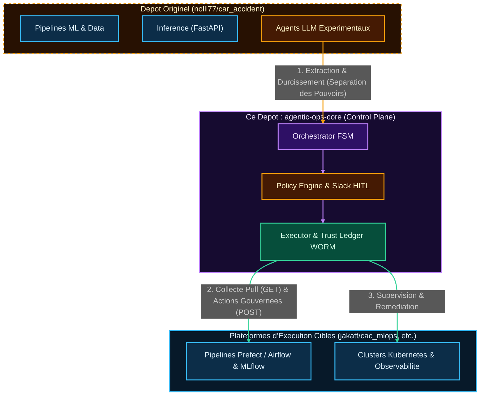

# Genèse du Projet Agentic-Ops

Le projet **Agentic-Ops** n'est pas né d'une page blanche. Il s'agit d'une extraction architecturale (*spin-off*) issue du dépôt monolithique originel : **[nolll77/car_accident](https://github.com/nolll77/car_accident)**.

---

## 1. Origine : Le Monolithe `car_accident`
Le dépôt originel `car_accident` était un monorepo MLOps regroupant l'ensemble de la chaîne de valeur :
- Les données brutes (`ONISR`).
- Les pipelines d'entraînement (Data Engineering & ML Engineering).
- Le déploiement de l'API (`FastAPI`).
- **Le Control Plane expérimental d'orchestration LLM**.

Au fur et à mesure que l'architecture a gagné en maturité, il est devenu évident que le "cerveau" (les agents LLM et le moteur de politiques) ne devait pas cohabiter dans le même dépôt que les "muscles" (les modèles de Machine Learning et les APIs d'inférence).

## 2. L'Extraction : Naissance d'`Agentic-Ops`
Pour respecter les principes SRE de "Séparation des Responsabilités" (*Separation of Concerns*) et de **Zero-Trust**, le Control Plane autonome a été extrait dans ce dépôt dédié : `agentic-ops-core`.

Cette scission a permis :
1. **L'Agnosticisme** : `Agentic-Ops` peut désormais se brancher sur n'importe quel projet MLOps (y compris la plateforme de production [`jakatt/cac_mlops`](https://github.com/jakatt/cac_mlops)), et non plus seulement sur le dépôt historique `car_accident`.
2. **Le Durcissement** : L'implémentation de politiques de sécurité strictes (*Policy-as-Code*, `Evidence Store WORM`, `Prompt Guard`, `Slack HITL HMAC-SHA256`).

---

## 3. Schéma de Séparation (`Spin-off`)

