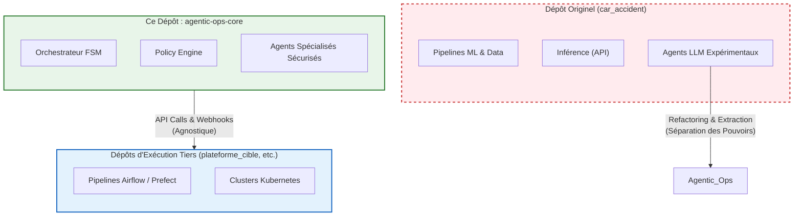

# 🌌 Genèse du Projet Agentic-Ops

Le projet **Agentic-Ops** n'est pas né d'une page blanche. Il s'agit d'une extraction architecturale (spin-off) issue du dépôt monolithique originel : **[nolll77/car_accident](https://github.com/nolll77/car_accident)**.

---

## 1. Origine : Le Monolithe "car_accident"
Le dépôt originel `car_accident` était un immense monorepo MLOps regroupant l'ensemble de la chaîne de valeur :
- Les données brutes (ONISR).
- Les pipelines d'entraînement (Data Engineering & ML Engineering).
- Le déploiement de l'API (FastAPI).
- **Le Control Plane expérimental d'orchestration LLM**.

Au fur et à mesure que l'architecture a gagné en maturité, il est devenu évident que le "cerveau" (les agents LLM) ne devait pas cohabiter dans le même dépôt que les "muscles" (les modèles de Machine Learning et les APIs).

## 2. L'Extraction : Naissance d'Agentic-Ops
Pour respecter les principes SRE de "Séparation des Responsabilités" (Separation of Concerns) et de **Zero-Trust**, le Control Plane autonome a été extrait dans ce dépôt dédié : `agentic-ops-core`.

Cette scission a permis :
1. **L'Agnosticisme** : Agentic-Ops peut désormais se brancher sur n'importe quel projet MLOps (y compris le dépôt de production `plateforme_cible`), et non plus seulement sur le repo historique `car_accident`.
2. **Le Durcissement** : L'implémentation de politiques de sécurité draconiennes (Policy-as-Code, Evidence Store, Prompt Guard).

---

## 3. Schéma de Séparation (Spin-off)

