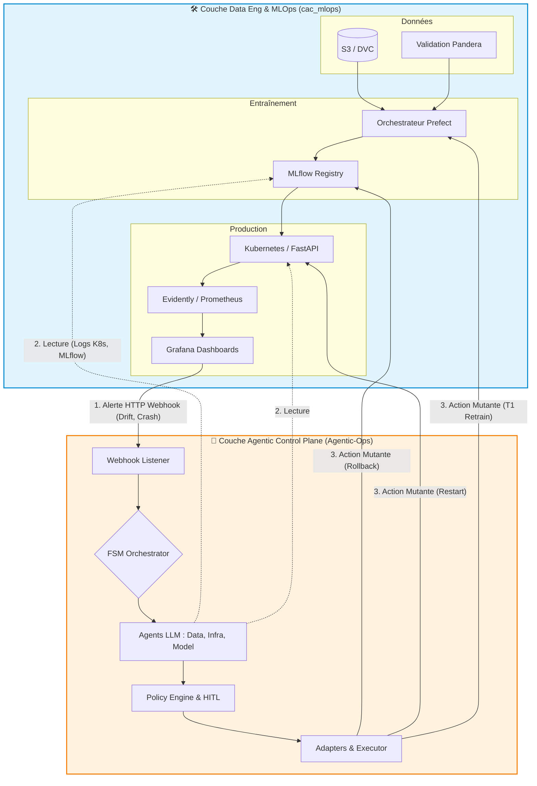

# 🚀 Guide d'Intégration Spécifique : Agentic-Ops 🤝 CAC MLOps

Ce guide est destiné à expliquer pas à pas comment connecter l'architecture **Agentic-Ops** (Control Plane Agentique) au dépôt d'exécution **[cac_mlops](https://github.com/jakatt/cac_mlops)**.

Agentic-Ops agit comme le **cerveau** (SRE autonome) tandis que `cac_mlops` fournit les **muscles** (Data Engineering, infrastructure, modèles).

---

## 1. Vision Globale : L'Alliance des Deux Architectures

### A. La Couche d'Exécution (Le projet `cac_mlops`)
Le projet de l'infrastructure distante est une architecture de Data Engineering et de MLOps classique, très robuste, qui gère la matière première et la mise en production :
- **Data Engineering** : Validation des données (Pandera), Versioning (DVC / S3).
- **ML Engineering** : Entraînement (LightGBM), Tracking & Model Registry (MLflow).
- **Orchestration** : Exécution des pipelines (Prefect) et CI/CD (GitHub Actions).
- **Inférence & Infra** : API (FastAPI) servie sur un cluster Kubernetes (Kapsule) protégé par Tailscale.
- **Monitoring** : Surveillance (Prometheus / Grafana) et dérive des données (Evidently).

👉 *Limitation actuelle de cette couche* : Quand une anomalie survient (ex: Data Drift), Grafana se contente d'envoyer un email à un humain qui doit tout réparer à la main.

### B. La Couche de Contrôle (Le projet `Agentic-Ops`)
Notre projet vient se brancher "par-dessus" cette infrastructure. Il intercepte l'alerte, mandate des agents LLM pour analyser les logs et les métriques de `cac_mlops`, puis déclenche les actions de réparation (via Prefect ou Kubernetes) après une validation humaine ultra-rapide et sécurisée.

---

## 2. Le Schéma d'Architecture Combinée



---

## 3. Guide d'Implémentation Étape par Étape

### 🏗️ Prérequis : Réseau (Tailscale)
L'infrastructure `cac_mlops` est sécurisée derrière **Tailscale**.
👉 Le serveur exécutant `Agentic-Ops` doit installer Tailscale et rejoindre le même réseau (Tailnet) que `cac_mlops` pour permettre la communication entre les APIs.

### Étape 1 : Ingestion (Grafana ➔ Agentic-Ops)
Actuellement, `cac_mlops` envoie des emails via Grafana lorsqu'Evidently détecte une dérive. Nous allons câbler ces alertes vers notre système autonome.

1. Pour le test local initial, lancer le récepteur sans le rendre accessible sur le réseau :
   ```bash
   uvicorn agentic_ops.entrypoints.grafana_webhook:app --host 127.0.0.1 --port 8000
   ```
   Vérifier `http://127.0.0.1:8000/healthz`, puis envoyer une alerte factice dans un autre terminal :
   ```bash
   curl -i -X POST http://127.0.0.1:8000/webhook/alerts \
     -H 'Content-Type: application/json' \
     --data '{"receiver":"local-test","status":"firing","alerts":[{"status":"firing","labels":{"alertname":"LocalSmokeTest","severity":"info"}}]}'
   ```
   Le récepteur doit répondre `202` avec `{"status":"received","alerts_received":1}`. À ce stade, il journalise uniquement le nombre d'alertes et ne lance aucune action ni connexion aux services distants.
2. N'exposer le récepteur à Grafana qu'après ce test et après avoir choisi/configuré un accès réseau autorisé. Une écoute sur `127.0.0.1` n'est joignable que depuis cette machine.
3. Ouvrir le **Grafana** de `cac_mlops`.
4. Naviguer vers **Alerting** ➔ **Contact points**.
5. Créer un nouveau Point de Contact :
   - **Name** : `Agentic-Ops Webhook`
   - **Integration** : `Webhook`
   - **URL** : `http://<ip-tailscale-agentic>:8000/webhook/alerts`
6. Dans **Notification policies**, router les alertes (Data Drift, Crash API) vers ce nouveau Webhook.

*Résultat : Toute chute de performance réveille l'orchestrateur Agentic-Ops.*

### Étape 2 : Investigation en Lecture Seule (Contexte)
L'agent a besoin d'analyser l'état du système de `cac_mlops`.

1. **Pour lire MLflow (Le Model Registry)** :
   - Dans le `.env` de `Agentic-Ops`, ajouter l'URL MLflow :
     ```bash
     MLFLOW_TRACKING_URI="http://<ip-tailscale-cac-mlops>:5000"
     ```
2. **Pour lire Kubernetes (Le cluster Kapsule)** :
   - Récupérer le `kubeconfig` du cluster Kapsule Scaleway.
   - Indiquer le chemin dans le `.env` de `Agentic-Ops` :
     ```bash
     KUBECONFIG="/chemin/vers/kubeconfig.yaml"
     ```

*Résultat : Les agents LLM (Data, Infra, Model) peuvent requêter les métriques d'accuracy de `lgbm_accidents v4` et lire les logs des Pods FastAPI sans aucun droit de modification.*

### Étape 3 : Exécution Mutante (Actuateurs)
Une fois le diagnostic établi et l'action validée mathématiquement par notre *Policy Engine* et approuvée par un humain via Slack, l'Executor d'Agentic-Ops doit déclencher l'action chez `cac_mlops`.

**Scénario A : Relancer l'entraînement (Déclencheur Prefect)**
1. Créer une **API Key** dans l'interface Prefect de `cac_mlops`.
2. Dans le module `executor.py` d'Agentic-Ops, implémenter l'adaptateur pour l'action `PROPOSE_RETRAIN` :
   ```python
   import requests

   def trigger_prefect_retrain():
       url = "http://<ip-tailscale-prefect>:4200/api/deployments/<id-du-deploiement>/create_flow_run"
       headers = {"Authorization": "Bearer VOTRE_CLEF_PREFECT"}
       requests.post(url, headers=headers, json={})
   ```

**Scénario B : Rollback d'urgence (MLflow + Kubernetes)**
1. Dans `executor.py`, pour l'action `ROLLBACK_MODEL` :
   ```python
   from mlflow import MlflowClient
   import subprocess

   client = MlflowClient()

   def rollback_mlflow():
       # Déclasse la version 4 fautive
       client.transition_model_version_stage(name="lgbm_accidents", version=4, stage="Archived")
       # Remet la version 3 fonctionnelle
       client.transition_model_version_stage(name="lgbm_accidents", version=3, stage="Production")

       # Force le redémarrage du pod d'inférence pour charger le bon modèle
       subprocess.run(["kubectl", "rollout", "restart", "deployment/fastapi-model"])
   ```

---

## 🎬 4. Scénario de Démonstration (Soutenance)
Pour démontrer la synergie absolue des deux projets lors de la soutenance :

1. Montrer le Cockpit `cac_mlops` (`mlops.jakat-inc.fr`) opérationnel.
2. **Provoquer un chaos** : Injecter de fausses données absurdes ou supprimer un Pod Kubernetes manuellement.
3. **Le Flow visuel** :
   - **Grafana** (cac_mlops) s'affole et tire le Webhook.
   - Le **Terminal Agentic-Ops** s'anime, les agents LLM débattent et trouvent l'origine (`INVESTIGATING` -> `DIAGNOSED`).
   - Le canal **Slack** reçoit une demande signée : *"L'Agent demande un ré-entraînement sur Prefect. Approuvez-vous ?"*
   - Clic sur **"Approuve"**.
   - L'interface **Prefect** (cac_mlops) démarre toute seule son pipeline `T1_retrain` de ré-entraînement.

**Conclusion** : Le système MLOps d'exécution est désormais piloté par une intelligence artificielle autonome, sous le contrôle absolu de la cryptographie et de l'humain.
