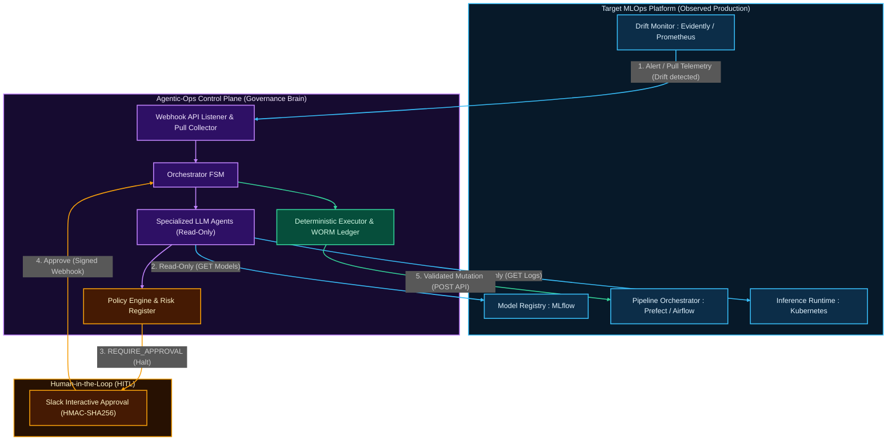

# Agentic-Ops Control Plane


> **Language / Langue** : **English (Main Documentation)** | **[Lire la documentation complète en Français (README_FR.md)](README_FR.md)**

**Agentic-Ops** is an enterprise-grade *MLOps Control Plane* designed to orchestrate AI Agents (LLMs) in resolving production incidents (`Data Drift`, `Model Staleness`, `OOMKilled Pods`).

Unlike traditional agentic frameworks (`LangChain`, `AutoGen`) that prioritize unchecked autonomy, `Agentic-Ops` is engineered around core **SRE (Site Reliability Engineering)** pillars: Determinism, Observability, Distributed Security (`Fail-Closed`), and asynchronous `Human-in-the-Loop (HITL)` governance.

> **Official Deployment & Interconnection Reports**:
> 1. **Live Serverless Auto-Wake Production Instance (`Render` + `Tailscale` + `cron-job.org`)**:  
>    - **Live Control Plane Status**: **[`https://agentic-ops-5ebv.onrender.com/`](https://agentic-ops-5ebv.onrender.com/)**
>    - **Live Tailscale Mesh Status (`100.85.198.81`)**: **[`https://agentic-ops-5ebv.onrender.com/api/tailscale/status`](https://agentic-ops-5ebv.onrender.com/api/tailscale/status)**
>    - **Live Read-Only Pull Snapshot (`jakatt/cac_mlops`)**: **[`https://agentic-ops-5ebv.onrender.com/api/cac/snapshot`](https://agentic-ops-5ebv.onrender.com/api/cac/snapshot)**
> 2. **Cloud Sandbox Validation (`Docker Agentic Platform`)**: End-to-end deployment on an isolated micro-VM and line-by-line technical interpretation of all 30 unit, adversarial, and cryptographic security tests:  
>    **[Read the Cloud Sandbox Deployment & Validation Report (DOCKER_SANDBOX_VALIDATION.md)](DOCKER_SANDBOX_VALIDATION.md)**
> 3. **Tailscale Pull Interconnection with Target Platform [`jakatt/cac_mlops`](https://github.com/jakatt/cac_mlops)**: Userspace `Tailscale` tunneling (`--tun=userspace-networking` / `SOCKS5` proxy / `DERP` relays), strict read-only ingestion across 5 observability sources (`Loki`, `Prometheus`, `MLflow`, `Prefect`, `Evidently`), and validation via 13 unit tests:  
>    **[Read the Tailscale Pull Connector Architecture & Validation Report (CAC_TAILSCALE_PULL_CONNECTOR.md)](CAC_TAILSCALE_PULL_CONNECTOR.md)**

---

## Global Architecture (Hexagonal)

The system is built on a **Hexagonal Architecture** coupled with a strict **Finite State Machine (FSM)**.

1. **Orchestrator (FSM)**: Coordinates the strict lifecycle of an incident (`DETECTED` -> `INVESTIGATING` -> `DIAGNOSED` -> `PLANNED` -> `AWAITING_APPROVAL` / `EXECUTING` -> `RESOLVED` / `DENIED`).
2. **Policy Engine**: The governance brain. Evaluates every proposed action against a declarative YAML manifest (`autonomy_policy.yaml`) to determine the permitted level of autonomy.
3. **Trust Ledger (Evidence Store)**: Immutable cryptographic registry (`WORM`). Every decision generates a canonical hash chained to the previous block (`Merkle` chain).
4. **Executor & Model Registry (Simulated / Adapter)**: Executes approved actions and strictly governs model lifecycle transitions (`ModelRegistryStatusEnum`, `ModelDeploymentStatusEnum`).
5. **Agent Tools (Sandboxing)**: Tools exposed to LLMs, confined at the OS process level with an enforced hardware/OS timeout.

---

## Project Structure (ASCII Tree)

The application architecture is reflected in this formal directory layout, where each module enforces a critical link in the security chain:

```text
agentic-ops-core/
├── agentic_ops/
│   ├── core/
│   │   ├── orchestrator.py       # Main FSM. Physically halts on REQUIRE_APPROVAL, handles resumption (resume_episode).
│   │   ├── policy.py             # Governance engine (Pydantic), evaluates permission manifests.
│   │   ├── executor.py           # Last-mile actuator. Mutates the Model Registry. Returns FAILED on business rule rejection.
│   │   ├── evidence.py           # WORM Trust Ledger. Canonical JSON serialization, block chaining (previous_hash).
│   │   ├── distributed.py        # Idempotency and Rate Limiting via Redis (Atomic pipelines & distributed locks).
│   │   └── circuit_breaker.py    # FinOps protection against Monitoring Storms (automatic degraded mode fallback).
│   ├── adapters/
│   │   ├── cac_pull_collector.py # Tailscale Pull Connector (GET-only) targeting jakatt/cac_mlops (Loki, Prometheus, MLflow, Prefect).
│   │   └── registry_adapter.py   # Protocol and Gatekeeper simulation (e.g., automatic rejection if F1 < 0.85).
│   ├── governance/
│   │   ├── autonomy_policy.yaml  # Strict production MLOps manifest (approval requirements).
│   │   └── shadow_policy.yaml    # Security policy A/B testing (divergence analysis).
│   ├── cli/
│   │   └── main.py               # FastAPI server exposing /, /healthz, /ready, /api/tailscale/status, /api/cac/snapshot, /slack/interactive.
│   └── entrypoints/
│       └── slack_webhook.py      # HITL: Human approval ingestion (HMAC-SHA256 verification, 5m anti-replay window).
├── scripts/
│   └── entrypoint.sh             # Zero-Click Auto-Wake boot script (Redis :6379 + Tailscale SOCKS5 :1055 + TS_STATE_B64 + FastAPI).
├── docs/
│   └── mlops_simulation_scenarios_registry.md # MLOps crisis simulation scenario registry.
├── tests/
│   ├── adapters/
│   │   └── test_cac_pull_collector.py # 13 unit tests (JSON parsing, offline resilience, strict read-only enforcement).
│   ├── integration/
│   │   └── test_registry_e2e.py       # Formal E2E proof of Orchestrator blocking without human intervention.
│   └── security/
│       ├── test_trust_ledger.py       # Tamper-evident detection on the WORM blockchain.
│       └── test_executor.py           # Security invariant tests (OS-level process isolation & sandboxing).
├── Dockerfile                         # Production Auto-Wake container image (Render / Koyeb / Self-Hosted, Port 8001).
├── Dockerfile.hf                      # Hugging Face Spaces Auto-Wake container image (Port 7860, non-root UID 1000).
├── DOCKER_SANDBOX_VALIDATION.md       # Deployment and validation report on Docker Cloud Sandbox.
├── CAC_TAILSCALE_PULL_CONNECTOR.md    # Architecture and validation of the Tailscale Pull Connector to CAC MLOps.
├── README.md                          # Main documentation (English).
├── README_FR.md                       # Complete documentation (French).
└── pyproject.toml                     # Dependency manifest (Pydantic, FastAPI, Redis, httpx[socks], etc.)
```

---

## Live Production Interconnection: Plugging `Agentic-Ops` into `CAC MLOps` ([`jakatt/cac_mlops`](https://github.com/jakatt/cac_mlops))

**`Agentic-Ops` is not another model-training platform: it is an agnostic "Control Plane" (an SRE governance brain) that plugs directly on top of an existing production MLOps execution platform.**

In our reference deployment, `Agentic-Ops` runs both in an isolated `Docker Agentic Platform` micro-VM (Tailscale IP `100.102.123.121`) and as a live **24/7 Auto-Wake PaaS Web Service on `Render`** (`https://agentic-ops-5ebv.onrender.com`, Tailscale IP **`100.85.198.81`**, hostname `agentic-ops-render`) connected to the target production platform `CAC MLOps`:
* **Target Platform GitHub Repository**: **[`https://github.com/jakatt/cac_mlops`](https://github.com/jakatt/cac_mlops)** (Road accident severity prediction platform).
* **Target Production Server (Scaleway VPS)**: `scw-jovial-dubinsky` — Tailscale IP: **`100.117.99.62`** — Public domain: `https://mlops.jakat-inc.fr`.
* **Live `Agentic-Ops` Control Plane (`Render`)**: **[`https://agentic-ops-5ebv.onrender.com`](https://agentic-ops-5ebv.onrender.com)** — Tailscale IP: **`100.85.198.81`**.
* **Dedicated Technical Connector Documentation**: **[`CAC_TAILSCALE_PULL_CONNECTOR.md`](CAC_TAILSCALE_PULL_CONNECTOR.md)**.

---

### A. End-to-End Architectural Connection Diagram (`Agentic-Ops` <-> `jakatt/cac_mlops` <-> `Slack HITL`)

The ASCII architecture diagram below illustrates all network connection points, the strict boundary between **read-only observability endpoints** and the **sanctuarized write zone**, as well as the human interaction loop via **Slack**:

```text
+=======================================================================================================+
| TARGET PRODUCTION MLOPS PLATFORM : jakatt/cac_mlops (Scaleway VPS scw-jovial-dubinsky)                |
| Repo : https://github.com/jakatt/cac_mlops  |  Tailscale IP : 100.117.99.62                           |
+=======================================================================================================+
|                                                                                                       |
|  [ ZONE 1 : OBSERVABILITY CONNECTION POINTS (AUTHORIZED - STRICT HTTP GET READ-ONLY) ]                |
|  +-------------------------------------------------------------------------------------------------+  |
|  | 1. Grafana Loki   (:3100) -> GET /loki/api/v1/query_range    (Alert logs, rollbacks, CI/CD)     |  |
|  | 2. Prometheus     (:9090) -> GET /api/v1/query               (cac_mlops_drift_share, model_info)|  |
|  | 3. MLflow Server  (:5001) -> GET /api/2.0/mlflow/...         (Alias @Production, F1-score, run) |  |
|  | 4. Prefect Server (:4200) -> GET /api/flow_runs              (Status of last 10 pipeline runs)  |  |
|  | 5. Evidently Web  (:443)  -> GET https://mlops.jakat-inc.fr/reports/drift/latest_summary.json   |  |
|  +------------------------------------------------+------------------------------------------------+  |
|                                                   |                                                   |
|  [ ZONE 2 : SANCTUARIZED ZONE (FORBIDDEN IN PULL MODE - PROTECTED BY LOGICAL FIREWALL) ]              |
|  +------------------------------------------------v------------------------------------------------+  |
|  | [X] POST /predict (Inference API)        -> Forbidden (would pollute prod DB & drift metrics)   |  |
|  | [X] POST /loki/api/v1/push               -> Forbidden (would inject fake alerts into prod)      |  |
|  | [X] POST/DELETE .../registered-models    -> Forbidden outside approved Executor (model mutation)|  |
|  | [X] POST /api/deployments/.../flow_run   -> Forbidden outside approved Executor (reset risk)    |  |
|  | [X] Port :7860 (Gradio Admin Cockpit)    -> Forbidden (triggers direct un-audited actions)      |  |
|  +-------------------------------------------------------------------------------------------------+  |
+===================================================|===================================================+
                                                    |
                                                    | Encrypted WireGuard Mesh Network (Tailscale)
                                                    | Firewall traversal via DERP Relays (Paris <-> Seattle)
                                                    | + Direct HTTPS stream for public Evidently drift report
                                                    v
+=======================================================================================================+
| GOVERNANCE CONTROL PLANE : AGENTIC-OPS (Docker Cloud Sandbox - Tailscale IP : 100.102.123.121)        |
+=======================================================================================================+
|                                                                                                       |
|  1. NETWORK INGESTION LAYER                                                                           |
|     [ tailscaled daemon (--tun=userspace-networking) ] ---> [ Local SOCKS5 Proxy : 127.0.0.1:1055 ]   |
|                                                                      |                                |
|                                                                      v                                |
|  2. OBSERVABILITY ADAPTER (agentic_ops/adapters/cac_pull_collector.py)                                |
|     [ CacPullCollector.collect_all() ]                                                                |
|       |-- Queries all 5 endpoints via HTTP GET (20s timeout)                                          |
|       |-- Absorbs network failures (Returns ONLINE, PARTIAL, or REMOTE_TARGET_OFFLINE without crash)  |
|       +-- Emits an immutable Pydantic contract : CacCollectedSnapshot                                 |
|                                                                      |                                |
|                                                                      v                                |
|  3. DETERMINISTIC FACT EXTRACTION & COGNITIVE DIAGNOSIS                                               |
|     [ compute_facts() ] ---> Objectively extracts : drift_share=0.34, drifted columns, F1=0.883       |
|     [ Investigator LLM Agent ] -> Analyzes quarantined facts (<untrusted_data>) & proposes intent     |
|                                   (e.g., ActionIntent = TRIGGER_RETRAINING or PROMOTE_MODEL)          |
|                                                                      |                                |
|                                                                      v                                |
|  4. DETERMINISTIC GOVERNANCE ENGINE (agentic_ops/core/orchestrator.py & policy.py)                    |
|     [ PolicyEngine ] -> Evaluates ActionIntent against autonomy_policy.yaml and risk_register.yaml    |
|       |-- If Action = Low Risk (e.g., INVESTIGATE) --------> Decision = ALLOW                         |
|       |-- If Action = Forbidden or Exceeds Redis Quota ----> Decision = DENY (Immediate block)        |
|       +-- If Action = Critical (PROMOTE_MODEL / RETRAIN) --> Decision = REQUIRE_APPROVAL              |
|                                                                      |                                |
|     [ Orchestrator FSM ] -> Transitions to AWAITING_APPROVAL and PHYSICALLY HALTS.                    |
|                             Persists state in SQLite (WAL) + Acquires Redis semantic idempotency lock.|
+===================================================|===================================================+
                                                    |
                      +-----------------------------+-----------------------------+
                      | 5. OUTBOUND NOTIFICATION                                  | 6. SIGNED INBOUND WEBHOOK
                      |    (Slack Block Kit Message)                              |    POST /webhooks/slack (:8001)
                      v                                                           |    (HMAC-SHA256 Signature + 5m TTL)
+=================================================================================|=====================+
| HUMAN-IN-THE-LOOP INTERFACE (SLACK)                                             |                     |
|                                                                                 |                     |
|  +---------------------------------------------------------------------------+  |                     |
|  | [MLOPS ALERT - DATA-042] Data Drift detected on jakatt/cac_mlops          |  |                     |
|  | - Source : Prometheus (cac_mlops_drift_share = 34%) & Evidently           |  |                     |
|  | - Drifted columns : age_conducteur, hrmn, surf                            |  |                     |
|  | - Active model : lgbm_accidents v7 (F1 = 0.883)                           |  |                     |
|  | - Proposed Agent Action : TRIGGER_RETRAINING                              |  |                     |
|  |                                                                           |  |                     |
|  |   Button 1 : [ APPROVE EXECUTION ]          Button 2 : [ REJECT (DENY) ]  +--+                     |
|  +---------------------------------------------------------------------------+                        |
+=======================================================================================================+
                                                    |
                                                    | 7. TRANSACTIONAL RESUMPTION (If "APPROVE" verified)
                                                    v
+=======================================================================================================+
| LAST-MILE EXECUTION & EVIDENCE LEDGER (agentic_ops/core/executor.py & evidence.py)                    |
|                                                                                                       |
|  1. [ slack_webhook.py ] -> Verifies HMAC-SHA256, anti-replay (< 5 min), YAML approver group,         |
|                             and acquires an atomic SQLite lock (BEGIN IMMEDIATE) against double-click.|
|  2. [ orchestrator.resume_episode() ] -> Unlocks the FSM (AWAITING_APPROVAL -> EXECUTING).            |
|  3. [ Executor ] -> Sole module authorized to emit the validated write request.                       |
|  4. [ WORM Trust Ledger (evidence.py) ] -> Seals the complete episode (CAC Snapshot + Decision +      |
|                             Slack Approver Identity + Execution Result) with SHA-256 block chaining   |
|                             (`previous_hash`) and `HMAC-SHA512` cryptographic signature.              |
+=======================================================================================================+
```

---

### B. Breakdown of the 5 Observability Connection Points (`CacPullCollector`)

To monitor the [`jakatt/cac_mlops`](https://github.com/jakatt/cac_mlops) platform without ever disrupting its production operations, [`agentic_ops/adapters/cac_pull_collector.py`](agentic_ops/adapters/cac_pull_collector.py) polls five specific read-only endpoints:

| # | Remote Service (`jakatt/cac_mlops`) | Address & Port | Polled HTTP Route (`GET` Only) | Observability Data Extracted for `Agentic-Ops` |
| :--- | :--- | :--- | :--- | :--- |
| **1** | **Grafana Loki** | `100.117.99.62:3100` (via `SOCKS5`) | `GET /loki/api/v1/query_range` | LogQL query `{service="prefect-worker"} \|= "event=alert"` over a 6h rolling window. Captures structured JSON alerts (`risk_id`, automated rollbacks, pipeline errors). |
| **2** | **Prometheus** | `100.117.99.62:9090` (via `SOCKS5`) | `GET /api/v1/query` | Queries 3 real-time gauges/counters: `cac_mlops_drift_share` (ratio of drifted features), `mlops_model_info{alias="Production"}` (active model), and `http_requests_total` (API traffic). |
| **3** | **MLflow Registry** | `100.117.99.62:5001` (via `SOCKS5`) | `GET /api/2.0/mlflow/registered-models/alias` & `GET /api/2.0/mlflow/runs/get` | Identifies the exact version of the `lgbm_accidents` model holding the `@Production` alias, its `run_id`, governance tags, and evaluation metrics (`f1_score`, `accuracy`). |
| **4** | **Prefect Server** | `100.117.99.62:4200` (via `SOCKS5`) | `GET /api/flow_runs?limit=10&sort=START_TIME_DESC` | Retrieves the execution state of the last 10 flow runs (`COMPLETED`, `FAILED`), their names, and timestamps (`start_time`, `end_time`) to detect training failures. |
| **5** | **Evidently Drift** | `mlops.jakat-inc.fr:443` (Direct HTTPS) | `GET /reports/drift/latest_summary.json` | Downloads the latest statistical drift summary generated by `Evidently`: report date, global `drift_share`, and exact list of drifted features (`drifted_columns`, e.g., `["age_conducteur", "hrmn", "surf"]`). |

#### Resilience to Remote Server Power-Down (`Offline Tolerance`)
If the remote Scaleway VPS `scw-jovial-dubinsky` is powered down (or if an individual service is restarting), `CacPullCollector.collect_all()` gracefully catches `httpx.ConnectError` and `httpx.TimeoutException`:
- If all 5 sources respond: `snapshot.status = RemoteServiceStatus.ONLINE`.
- If 1 to 4 sources fail: `snapshot.status = RemoteServiceStatus.PARTIAL` (data from healthy services is preserved and processed).
- If the VPS is completely powered off: `snapshot.status = RemoteServiceStatus.REMOTE_TARGET_OFFLINE` (the `Agentic-Ops` orchestrator remains on standby without raising unhandled exceptions).

---

### C. How the Interactive Slack Alert & Approval Loop Works (`HITL`)

The interaction between telemetry ingested from [`jakatt/cac_mlops`](https://github.com/jakatt/cac_mlops) and human decision-making on `Slack` follows a **6-step cryptographic security protocol**:

#### 1. Ingestion & Episode Triggering
The orchestrator runs a collection cycle via `CacPullCollector().collect_all()` (either on a scheduled `Pull` interval or triggered by an inbound alert webhook). The resulting `CacCollectedSnapshot` reveals, for example, that `cac_mlops_drift_share` has reached `0.34` (34% of features have drifted) and that an `event=alert` entry appeared in `Loki`.

#### 2. Deterministic Fact Computation (`System Facts`) & Prompt Quarantine
Before invoking any LLM, `compute_facts()` mathematically extracts verified system facts from the snapshot. Raw log lines coming from `Loki` are wrapped inside `<untrusted_data>` quarantine tags by the `Prompt Guard` so that no adversarial prompt injection hidden inside an external log can hijack the agent.

#### 3. Cognitive Diagnosis & Interception by the `PolicyEngine`
The cognitive agent analyzes the context (active model `lgbm_accidents` v7, drift detected on `age_conducteur`, `hrmn`, `surf`) and outputs a structured intent: `ActionIntent(action="TRIGGER_RETRAINING", target="lgbm_accidents")` or `PROMOTE_MODEL`.
The `PolicyEngine` immediately evaluates this intent against [`autonomy_policy.yaml`](agentic_ops/governance/autonomy_policy.yaml):
- Any action that mutates the production model or launches a heavy training pipeline is classified as **`REQUIRE_APPROVAL`**.
- The state machine (`Orchestrator FSM`) transitions to **`AWAITING_APPROVAL`** and **physically halts**. The AI agent is deactivated.

#### 4. Dispatching the Interactive Slack Alert
The Control Plane dispatches a formatted `Slack Block Kit` notification to the MLOps on-call channel containing:
- The unique `episode_id` and `risk_id`.
- A summary of the evidence collected from `jakatt/cac_mlops` (`Prometheus`/`Evidently` drift share, current `MLflow` metrics, status of the latest `Prefect` flow).
- The proposed action and its computed `blast_radius`.
- Two interactive action buttons: **`[ APPROVE ]`** and **`[ DENY ]`**.

#### 5. Receiving & Cryptographically Verifying the Human Click (`slack_webhook.py`)
When the on-call SRE clicks **`[ APPROVE ]`** in Slack, Slack's servers send a `POST /webhooks/slack` request to our `FastAPI` endpoint (port `8001`). [`agentic_ops/entrypoints/slack_webhook.py`](agentic_ops/entrypoints/slack_webhook.py) enforces **4 sequential security gates**:
1. **Cryptographic Authenticity (`HMAC-SHA256`)**: Verifies the `X-Slack-Signature` header computed with `SLACK_SIGNING_SECRET` over the raw request body. Any unsigned or tampered request is rejected in `0.002s` with **`HTTP 401 Unauthorized`**.
2. **Anti-Replay Protection (`Replay Attack`)**: Inspects `X-Slack-Request-Timestamp`. Requests older than **5 minutes** or carrying a previously seen signature are rejected.
3. **RBAC Authorization (`approvers.yaml`)**: Verifies that the Slack user who clicked the button belongs to the authorized approver group for that criticality tier.
4. **Atomic Transactional Lock (`SQLite BEGIN IMMEDIATE`)**: If two operators click the Slack button simultaneously (the *Double-Click* race condition), SQLite's immediate transaction lock guarantees that only the first click transitions the record from `PENDING -> APPROVED`, while the second is rejected.

#### 6. Last-Mile Execution & `WORM` Sealing (`Trust Ledger`)
Once approval is verified:
- `orchestrator.resume_episode()` rehydrates the episode and transitions the FSM to `EXECUTING`.
- The deterministic `Executor` module performs the authorized action (and only that action).
- The entire episode (initial `CAC MLOps` snapshot, AI proposal, Slack approver identity, timestamps, and execution result) is serialized into canonical JSON, chained to the previous block (`previous_hash` `SHA-256`), and signed with `HMAC-SHA512` inside the immutable **`Trust Ledger` (`evidence.py`)**.

```mermaid
%%{init: {'theme': 'dark', 'themeVariables': {'actorBkg': '#0f172a', 'actorBorder': '#38bdf8', 'actorTextColor': '#f8fafc', 'actorLineColor': '#64748b', 'signalColor': '#e2e8f0', 'signalTextColor': '#f8fafc', 'noteBkgColor': '#1e1b4b', 'noteBorderColor': '#c084fc', 'noteTextColor': '#f3e8ff', 'activationBkgColor': '#334155', 'activationBorderColor': '#38bdf8'}}}%%
sequenceDiagram
    autonumber
    participant CAC as Target Platform jakatt/cac_mlops (100.117.99.62)
    participant Pull as CacPullCollector (SOCKS5 :1055)
    participant FSM as Orchestrator FSM & PolicyEngine
    participant Slack as On-Call SRE (Slack HITL)
    participant Exec as Executor & WORM Trust Ledger

    rect rgb(12, 45, 72)
    Note over CAC, Pull: Phase 1 : Passive Observation (100% GET Read-Only - Sapphire Zone)
    Pull->>CAC: GET Loki (:3100), Prometheus (:9090), MLflow (:5001), Prefect (:4200), Evidently (:443)
    CAC-->>Pull: JSON (drift_share=0.34, lgbm_accidents v7, LogQL alerts)
    Pull->>FSM: CacCollectedSnapshot (status=ONLINE)
    end

    rect rgb(69, 26, 3)
    Note over FSM, Slack: Phase 2 : Diagnosis & Fail-Closed Guardrail (Amber Zone)
    FSM->>FSM: compute_facts() + Agent Diagnosis -> ActionIntent(TRIGGER_RETRAINING)
    FSM->>FSM: PolicyEngine evaluates autonomy_policy.yaml -> REQUIRE_APPROVAL
    FSM->>Slack: Slack Block Kit Alert (CAC Evidence + [APPROVE] / [DENY] Buttons)
    Note over FSM: Physical halt in AWAITING_APPROVAL state (SQLite WAL)
    end

    rect rgb(6, 78, 59)
    Note over Slack, Exec: Phase 3 : Signed Human Approval & WORM Sealing (Emerald Zone)
    Slack->>FSM: Click [APPROVE] -> POST /webhooks/slack (HMAC-SHA256 Signed)
    FSM->>FSM: Verifies HMAC-SHA256 + Anti-Replay (<5m) + BEGIN IMMEDIATE Lock
    FSM->>Exec: resume_episode() -> Deterministic execution order
    Exec->>Exec: Seals full cryptographic proof in Trust Ledger (SHA-256 + HMAC-SHA512)
    end
```



---

### D. Serverless Auto-Wake PaaS Deployment (`Render` + `Tailscale` Userspace + 24/7 `Keep-Alive`)

To allow `Agentic-Ops` to run continuously on a free-tier PaaS (`Render`, `Hugging Face Spaces`, or `Koyeb`) without ever requiring an operator to open an SSH terminal or click a console start button, the entire stack (`Redis` + `Tailscale` `SOCKS5` + `FastAPI`) is packaged inside a self-initializing container ([`Dockerfile`](Dockerfile), [`Dockerfile.hf`](Dockerfile.hf), and [`scripts/entrypoint.sh`](scripts/entrypoint.sh)).

#### 1. Live Production URLs & Endpoints (`Render` — `Frankfurt EU Central`)

| Endpoint / Console | Live URL | Method | Purpose & Behavior |
| :--- | :--- | :--- | :--- |
| **Root Auto-Wake & Daemon Status** | **[`https://agentic-ops-5ebv.onrender.com/`](https://agentic-ops-5ebv.onrender.com/)** | `GET` | **Primary Auto-Wake URL**. Visiting this URL in a browser or calling it via `fetch()` from an external frontend (`Vercel`) wakes the container automatically if asleep and returns the live status of local `Redis` (`127.0.0.1:6379`) and `Tailscale SOCKS5` (`127.0.0.1:1055`). |
| **Interactive SRE Web Terminal (`/console`)** | **[`https://agentic-ops-5ebv.onrender.com/console`](https://agentic-ops-5ebv.onrender.com/console)** | `GET` | **Zero-Cost SSH Shell Replacement**. Dark-mode browser terminal providing 1-click execution of `pytest` suites, `trust_ledger list`, `tailscale status` (with automatic PII redaction), `tailscale netcheck`, and `redis-cli PING`. |
| **Interactive `Swagger UI` API Console (`/docs`)** | **[`https://agentic-ops-5ebv.onrender.com/docs`](https://agentic-ops-5ebv.onrender.com/docs)** | `GET` | Interactive `OpenAPI` interface (`Try it out` -> `Execute`) for all endpoints and diagnostic commands. |
| **Whitelisted Diagnostic Runner** | **[`https://agentic-ops-5ebv.onrender.com/api/diagnostics/pytest_cac_connector`](https://agentic-ops-5ebv.onrender.com/api/diagnostics/pytest_cac_connector)** | `GET` | Executes a whitelisted diagnostic command inside the container (`pytest_cac_connector`, `pytest_security`, `pytest_all`, `trust_ledger_list`, `tailscale_status`, `tailscale_netcheck`, `tailscale_logs`, `redis_ping`, `system_info`). |
| **Keep-Alive Liveness Probe** | **[`https://agentic-ops-5ebv.onrender.com/healthz`](https://agentic-ops-5ebv.onrender.com/healthz)** | `GET` | Lightweight health check returning `{"status": "ok"}`. Polled every `10 minutes` by `cron-job.org` to prevent the `15-minute` free-tier inactivity spin-down. |
| **Daemon Readiness Probe** | **[`https://agentic-ops-5ebv.onrender.com/ready`](https://agentic-ops-5ebv.onrender.com/ready)** | `GET` | Verifies that both internal daemons (`redis_local_6379: true` and `tailscale_socks5_1055: true`) are listening inside the container. |
| **Tailscale Mesh Status & Manual Fallback Auth** | **[`https://agentic-ops-5ebv.onrender.com/api/tailscale/status`](https://agentic-ops-5ebv.onrender.com/api/tailscale/status)** | `GET` | Queries `tailscale --socket=/tmp/tailscaled.sock status --json`. Returns `"backend_state": "Running"`, `"tailscale_ips": ["100.85.198.81", ...]`, `"hostname": "agentic-ops-render"`, the exportable `"ts_state_b64"`, or a live clickable `"auth_url"` (`https://login.tailscale.com/a/...`) if manual re-authentication is ever required. |
| **On-Demand `CAC MLOps` Pull Snapshot** | **[`https://agentic-ops-5ebv.onrender.com/api/cac/snapshot`](https://agentic-ops-5ebv.onrender.com/api/cac/snapshot)** | `GET` | Triggers an immediate read-only collection (`CacPullCollector.collect_all()`, default `3.5s` per-service timeout) across all 5 `jakatt/cac_mlops` endpoints over the `Tailscale SOCKS5` tunnel (`127.0.0.1:1055`). |
| **Slack HITL Interactive Webhook** | `https://agentic-ops-5ebv.onrender.com/slack/interactive` | `POST` | Receives signed `Slack Block Kit` button callbacks (`HMAC-SHA256` + `5 min` anti-replay + `SQLite BEGIN IMMEDIATE` atomic lock). |
| **External Keep-Alive Scheduler (`cron-job.org`)** | **[`https://console.cron-job.org/jobs`](https://console.cron-job.org/jobs)** | `GET` (`Every 10m`) | Scheduled job (`Agentic-Ops Keep-Alive`) pinging `https://agentic-ops-5ebv.onrender.com/healthz` every `10 minutes` so the container and its `Tailscale` tunnel remain warm 24/7. |
| **Render Service Management Console** | **[`https://dashboard.render.com/web/srv-db6ojll9fdbs73dnlgsg`](https://dashboard.render.com/web/srv-db6ojll9fdbs73dnlgsg)** | `Web UI` | Real-time container logs ([`/logs`](https://dashboard.render.com/web/srv-db6ojll9fdbs73dnlgsg/logs)), environment variables ([`/env`](https://dashboard.render.com/web/srv-db6ojll9fdbs73dnlgsg/env)), and `Manual Deploy` button. |

#### 2. Anatomy of the Zero-Console Container Boot Sequence ([`scripts/entrypoint.sh`](scripts/entrypoint.sh))

Every time the container starts (whether on a fresh deployment or waking up from a `Render` inactivity spin-down), [`scripts/entrypoint.sh`](scripts/entrypoint.sh) executes a 5-stage deterministic initialization sequence:

1. **SOCKS5 Proxy Loop Prevention (`\x05\xff` Bug Fix)**:
   Explicitly executes `unset HTTP_PROXY HTTPS_PROXY ALL_PROXY http_proxy https_proxy all_proxy` before starting any daemon. This guarantees that `tailscaled` connects directly to `Tailscale` control servers (`controlplane.tailscale.com:443`) while confining the `socks5://127.0.0.1:1055` proxy strictly to the `httpx` transport inside [`cac_pull_collector.py`](agentic_ops/adapters/cac_pull_collector.py).
2. **Runtime Ephemeral `tmpfs` Initialization (`/tmp/state`)**:
   On serverless PaaS platforms (`Render`, `Hugging Face Spaces`), `/tmp` is mounted as a fresh in-memory `tmpfs` at container startup, wiping directories created during `docker build`. Both [`scripts/entrypoint.sh`](scripts/entrypoint.sh) (`mkdir -p /tmp/state`) and [`ApprovalRepo.__init__()`](agentic_ops/core/approvals.py) (`os.makedirs(os.path.dirname(os.path.abspath(path)), exist_ok=True)`) recreate `/tmp/state` dynamically at runtime so `SQLite WAL` (`/tmp/state/approvals.db`) never fails with `sqlite3.OperationalError`.
3. **Local `Redis` Daemon (`127.0.0.1:6379`)**:
   Starts `redis-server --daemonize yes --bind 127.0.0.1 --port 6379` inside the container, providing zero-latency atomic operations (`INCR` + `EXPIRE` for rate limiting and `SET NX EX` for semantic idempotency locks) without requiring an external paid Redis add-on.
4. **Userspace `Tailscale` Daemon & Non-Admin Session Persistence (`TS_STATE_B64` vs. `TS_AUTHKEY`)**:
   Starts `tailscaled --tun=userspace-networking --socks5-server=127.0.0.1:1055 --state=/tmp/tailscaled.state --socket=/tmp/tailscaled.sock` (requiring zero root `CAP_NET_ADMIN` or `/dev/net/tun` privileges). To persist authentication across ephemeral container restarts, two modes are supported:
   - **Mode A — `TS_STATE_B64` (Non-Admin Tailnet Member Persistence, Active on `Render`)**: When connected to a third-party `Tailnet` as an invited **Member** (without access to `https://login.tailscale.com/admin/settings/keys` to generate a `TS_AUTHKEY`), the operator authenticates the container once via [`/api/tailscale/status`](https://agentic-ops-5ebv.onrender.com/api/tailscale/status). Once connected, `/api/tailscale/status` exports the encrypted `/tmp/tailscaled.state` file as a `base64` string (`ts_state_b64`). Storing this string in `Render`'s `Environment Variables` under `TS_STATE_B64` allows `scripts/entrypoint.sh` (`echo "$TS_STATE_B64" | base64 -d > "$TS_STATE"`) to restore the authenticated node identity (`agentic-ops-render`, IP **`100.85.198.81`**) automatically before `tailscaled` starts.
   - **Mode B — `TS_AUTHKEY` (Tailnet Admin Headless Key)**: If the operator is an administrator of the `Tailnet`, setting `TS_AUTHKEY=tskey-auth-...` (reusable key) in the environment authenticates `tailscale up --authkey` headless at boot.
5. **Non-Blocking Background `tailscale up` & Immediate `FastAPI` Startup**:
   `tailscale up` is launched asynchronously in the background (`nohup tailscale --socket="$TS_SOCKET" up ... &`) so that `exec agentic-start` (`uvicorn` on `0.0.0.0:8001`) binds immediately and passes `Render`'s health check without ever blocking on network handshakes.

#### 3. Three-Layer Wake-Up, Keep-Alive & Manual Fallback Procedures

1. **Layer 1 — Automated 24/7 Keep-Alive (`cron-job.org`, Zero Cold-Start)**:
   - On `Render`'s free tier, instances spin down after **`15 minutes` of HTTP inactivity** (and take `~30 to 50 seconds` to cold-start on the first subsequent request).
   - To eliminate this `50-second` cold-start delay completely and keep the `Tailscale` tunnel (`100.85.198.81`) permanently up 24/7, a scheduled job on **[`https://console.cron-job.org/jobs`](https://console.cron-job.org/jobs)** (`Agentic-Ops Keep-Alive`) sends an `HTTP GET` request to **[`https://agentic-ops-5ebv.onrender.com/healthz`](https://agentic-ops-5ebv.onrender.com/healthz)** every **`10 minutes`**.
2. **Layer 2 — Automatic On-Demand HTTP Wake-Up (If `cron-job.org` is Paused)**:
   - Even if the external cron job is disabled and the container goes to sleep after `15 minutes` (or several hours), **any incoming HTTP request** automatically triggers `Render` to wake the container and run [`scripts/entrypoint.sh`](scripts/entrypoint.sh):
     - Opening **[`https://agentic-ops-5ebv.onrender.com/`](https://agentic-ops-5ebv.onrender.com/)** or **[`https://agentic-ops-5ebv.onrender.com/api/cac/snapshot`](https://agentic-ops-5ebv.onrender.com/api/cac/snapshot)** in any web browser.
     - Calling `fetch("https://agentic-ops-5ebv.onrender.com/ready")` from a frontend application (`Vercel`).
     - Clicking **`[ APPROVE ]`** or **`[ DENY ]`** on a `Slack HITL` alert (`POST /slack/interactive`).
3. **Layer 3 — Manual Wake-Up & Emergency Re-Authentication Commands (Just in Case)**:
   - **Manual Wake-Up from Terminal or Browser**:
     Simply open **[`https://agentic-ops-5ebv.onrender.com/`](https://agentic-ops-5ebv.onrender.com/)** in a browser, or run from any terminal:
     ```bash
     # 1. Wake the container and verify local Redis (:6379) & Tailscale SOCKS5 (:1055)
     curl -s https://agentic-ops-5ebv.onrender.com/ | python3 -m json.tool

     # 2. Verify Tailscale mesh connection (IP 100.85.198.81, BackendState: Running)
     curl -s https://agentic-ops-5ebv.onrender.com/api/tailscale/status | python3 -m json.tool

     # 3. Trigger a live read-only pull from jakatt/cac_mlops (100.117.99.62)
     curl -s "https://agentic-ops-5ebv.onrender.com/api/cac/snapshot?timeout=3.5" | python3 -m json.tool
     ```
   - **Manual `Tailscale` Session Recovery (If `TS_STATE_B64` is ever expired or revoked)**:
     1. Open **[`https://agentic-ops-5ebv.onrender.com/api/tailscale/status`](https://agentic-ops-5ebv.onrender.com/api/tailscale/status)** in your browser.
     2. If `"backend_state"` is `"NeedsLogin"`, the endpoint automatically generates a fresh `"auth_url": "https://login.tailscale.com/a/..."`. Open that URL in your browser and click **`Connect`**.
     3. Refresh **[`https://agentic-ops-5ebv.onrender.com/api/tailscale/status`](https://agentic-ops-5ebv.onrender.com/api/tailscale/status)**, copy the `"ts_state_b64"` string, and paste it into **[`https://dashboard.render.com/web/srv-db6ojll9fdbs73dnlgsg/env`](https://dashboard.render.com/web/srv-db6ojll9fdbs73dnlgsg/env)** under **`TS_STATE_B64`**.

---

## Core Features & Security Hardening (Red-Teaming)

This repository underwent an offensive architectural audit (*Red-Teaming*) and was hardened with an absolute "Fail-Closed" policy across the execution chain.

### 1. E2E Governance & Model Registry
- **Strict Enforcement (Non-Bypassable)**: The `Orchestrator` governs the MLOps lifecycle. If `PROMOTE_MODEL` is classified as `REQUIRE_APPROVAL`, the orchestrator physically halts. **No action is passed to the executor**.
- **Asynchronous Rehydration (HITL)**: Human approval triggers `orchestrator.resume_episode()`, which cryptographically validates the approver, resumes the state machine, and dispatches the order to the Executor.
- **Model Registry Gatekeeping**: The Executor drives the Model Registry directly. The registry rejects invalid promotions (e.g., F1 < 0.85 or incompatible schema), forcing the Executor to return a detectable `FAILED` status (rather than a fake `SIMULATED` status). Only one model version can be `ACTIVE` at any given time.

### 2. Cryptographic Traceability (WORM Trust Ledger)
- **Block Chaining (Previous Hash)**: The `EvidenceStore` assigns a `previous_hash` to every episode, guaranteeing strict chronological ordering.
- **Canonicalization**: Full state (Pydantic `mode='json'`) is encoded via `get_canonical_json` and hashed with `SHA-256`.
- **Tamper-Evident Verification**: Any attempt to manually alter a stored WORM file (`state_trace` = `APPROVE`) invalidates the cryptographic signature inside `verify_episode()`. Overwriting an existing episode ID locally is strictly forbidden.

### 3. Distributed Security & Concurrency (Redis)
- **Atomic Rate Limiting**: Caps destructive actions via atomic Redis pipelines (`INCR` + `EXPIRE`). Eliminates race conditions across multi-replica deployments.
- **Semantic Idempotency**: Distributed Redis locks (`SET NX EX`) keyed on the semantic incident fingerprint (`tenant:env:service:risk_id`) prevent duplicate executions.
- **Hardened Slack Webhook**: Human approval via Slack (Block Kit) requires `HMAC-SHA256` signature verification and rejects requests older than 5 minutes (Anti-Replay Attack).

### 4. Financial & Organizational Resilience
- **FinOps Circuit Breaker**: Cuts off LLM API calls during a "Monitoring Storm" (e.g., infinite alert loop) to protect cloud budgets, falling back to deterministic remediation (`CREATE_ISSUE`).
- **Shadow Mode (Security A/B Testing)**: The Orchestrator evaluates `shadow_policy.yaml` in parallel with the primary manifest and logs divergences without ever mutating production.
- **OS-Level Execution Isolation**: Every LLM tool runs inside a dedicated OS process (`multiprocessing.Process`) with a strict timeout to prevent OOMs or hanging workers.

### 5. Fact-Based Deterministic Decisions (PR2)
- **Policy Engine V2**: The LLM (Remediation Agent) only proposes an `ActionIntent` (action, target). The `PolicyEngine` computes risk attributes (`blast_radius`, `reversible`) itself from deterministic `action_catalog.yaml` and `risk_register.yaml` definitions.
- **System Facts**: Actual cluster state (telemetry, OOM pods, detected drift) is formally computed via `compute_facts()` outside LLM subjectivity, preventing hallucinations from bypassing governance rules.

### 6. Adversarial Harness & Confinement (PR3)
- **Prompt Guard**: Cryptographic quarantine (`<untrusted_data>`) around logs and payloads to neutralize indirect prompt injection attacks.
- **Red Team Scenarios**: Strict E2E tests (`known_gaps.yaml`) verifying that the orchestrator rejects any forged target or unauthorized action emitted by a compromised LLM.

### 7. Transactional Approval Store (PR4)
- **Atomic State Machine (SQLite WAL)**: Human approvals are governed via a `BEGIN IMMEDIATE` transaction lock to prevent the "Double Execution" (Double Click) vulnerability.
- **Anti-Replay & Cryptography**: Slack webhooks are verified via `HMAC-SHA256` over the raw request payload, with every signature stored with a TTL anti-replay window.
- **Governance as Code**: Approvers are explicitly declared in `approvers.yaml` with distinct group checks for L3 critical decisions.

### 8. Cryptographic Trust Ledger (PR5)
- **Append-Only WORM Storage**: The evidence store (`evidence.py`) uses immutable storage where every episode is cryptographically linked to its predecessor.
- **HMAC-SHA512 Signature**: Any local tampering (modifying a JSON file or index) mathematically breaks the chain, making it impossible for an attacker or compromised agent to conceal a toxic action.

### 9. Strict Distributed Concurrency (PR6)
- **Redis Idempotency Locks**: To prevent duplicate remediation across replicas, an atomic distributed lock is placed on the semantic fingerprint of the incident. The lock carries a TTL and is cryptographically bound to the owner process (`UUID`) to prevent lock stealing.
- **Fail-Closed in Production**: If the concurrency coordinator (`Redis`) becomes unreachable, the system enters an emergency Fail-Closed halt rather than silently falling back to an unsafe local cache.

### 10. Operational Hardening & CI/CD (PR7)
- **Least-Privilege Kubernetes RBAC**: The Control Plane's Kubernetes `ServiceAccount` only holds `get/list/watch` permissions on Pods (for log reading) and `patch` on Deployments (strictly to restart a faulty model deployment).
- **Kubernetes Reliability (Probes)**: The Helm chart includes `livenessProbe` and `readinessProbe` endpoints backed by native `FastAPI` routes (`/healthz`, `/ready`).
- **Deterministic Dependencies & CI Matrix**: Tested across Python 3.10, 3.11, and 3.12 via GitHub Actions with pinned container image tags.

---

## Internal Telemetry & Observability

SRE-grade metrics exposed via **Prometheus** (with bounded label cardinality):
- `agentic_ops_fsm_transitions_total`: Tracks Finite State Machine transitions.
- `agentic_ops_policy_decisions_total`: Ratio of `ALLOW`, `DENY`, and `REQUIRE_APPROVAL` decisions.
- `agentic_ops_circuit_breaker_status`: FinOps circuit breaker state.

---

## Separation of Powers (Cognitive vs. Executive Isolation)

One of the primary vulnerabilities of conventional autonomous agent frameworks is handing "network keys" directly to the AI. `Agentic-Ops` resolves this through a strict separation of privileges:

- **Investigation Phase (AI Reads - Sapphire Zone)**: LLM agents are **strictly restricted to read-only access** (Pull Mode). They query metric databases and logs to formulate a diagnosis. They are physically incapable of mutating production and only output a structured textual "modification intent".
- **Guardrail Phase (Policy & Human Gate - Amber Zone)**: The `PolicyEngine` intercepts the intent, halts the state machine, and requests human authorization via Slack.
- **Execution Phase (Code Writes - Emerald Zone)**: The AI agent is deactivated. The rigid, deterministic Python program (`Executor`) takes over **only** after human approval. It alone holds the API credentials and triggers mutations (Push Mode).

```mermaid
%%{init: {'theme': 'dark', 'themeVariables': {'actorBkg': '#0f172a', 'actorBorder': '#38bdf8', 'actorTextColor': '#f8fafc', 'actorLineColor': '#64748b', 'signalColor': '#e2e8f0', 'signalTextColor': '#f8fafc', 'noteBkgColor': '#1e1b4b', 'noteBorderColor': '#c084fc', 'noteTextColor': '#f3e8ff', 'activationBkgColor': '#334155', 'activationBorderColor': '#38bdf8'}}}%%
sequenceDiagram
    autonumber
    participant Platform as MLOps Platform
    participant Agent as LLM Agent (Investigator)
    participant FSM as Orchestrator & Policy
    participant Human as Human (Slack HITL)
    participant Exec as Python Executor (Actuator)

    rect rgb(12, 45, 72)
    Note over Platform, Exec: Phase 1 : Investigation (Read-Only - Sapphire Zone)
    Platform->>FSM: Alert Webhook (Inbound)
    FSM->>Agent: Wakes Agent
    Agent->>Platform: REST Queries (GET Logs, GET Metrics)
    Platform-->>Agent: JSON (System State)
    Agent-->>FSM: Intent : "Propose triggering retraining"
    end

    rect rgb(69, 26, 3)
    Note over FSM, Exec: Phase 2 : The Guardrail (Block & Wait - Amber Zone)
    FSM->>FSM: Policy Engine intercepts (REQUIRE_APPROVAL)
    FSM->>Human: Slack Approval Request
    Note over Agent: LLM Agent is deactivated
    end
    
    rect rgb(6, 78, 59)
    Note over Human, Exec: Phase 3 : Validation & Execution (Write - Emerald Zone)
    Human-->>FSM: Clicks [ APPROVE ] (Signed HMAC-SHA256)
    FSM->>Exec: Formal deterministic order
    Exec->>Platform: Mutating request (POST /deploy /retrain)
    Platform-->>Exec: Operation succeeded
    Exec-->>FSM: Sealing in WORM Trust Ledger
    end
```



### E2E Integration Architecture (`flowchart TD`)

**`Agentic-Ops` is not another MLOps platform; it is an agnostic "Control Plane" (a governance brain).** It connects to your existing stack via an Event-Driven Architecture and REST APIs, operating across 4 semantic color zones:
- **Sapphire Blue (`Target MLOps Platform`)**: Observed services (`Evidently`, `Prometheus`, `MLflow`, `Prefect/Airflow`, `Kubernetes`).
- **Amethyst Purple (`Cognitive & Orchestration Core`)**: Inbound listener, `Orchestrator FSM`, and read-only `LLM Agents`.
- **Amber Gold (`Governance Guardrail & HITL`)**: Deterministic `Policy Engine` and `Slack HITL` human approval gate.
- **Emerald Green (`Trusted Actuator`)**: The deterministic `Executor` performing validated mutations.



---

## Catalog of Physical Actions (`Executor` Mutation Capabilities)

The `Executor` module is the only component authorized to perform write operations. All mutations require `SIMULATION_MODE=False` and human approval via Slack (when required by policy).

#### 1. Code & Audit Integration (GitHub API)
*Asynchronous alerting and issue tracking.*
- **Target Action**: `CREATE_ISSUE`
- **Mechanism**: Forges a secure HTTP POST request with an access token to the GitHub API.
- **Result**: Instantly creates a remediation issue on the remote repository tagged `mlops-incident`, detailing the agent's root-cause analysis.

#### 2. Infrastructure Remediation (Kubernetes API)
*Emergency circuit-breaker action.*
- **Target Action**: `SCALE_TO_ZERO`
- **Mechanism**: Uses the official Python `kubernetes` client to patch the target deployment replica count.
- **Fail-Closed Security**: Constrained by a strict namespace/deployment *Whitelist*, followed by a post-execution *Read-After-Write* check.
- **Result**: Shuts down a malfunctioning inference API to stop bad predictions immediately.

#### 3. MLOps Pipeline Orchestration (Prefect API via Tunnel)
*Automated retraining trigger.*
- **Target Action**: `TRIGGER_RETRAINING`
- **Mechanism**: Targets the remote infrastructure over the overlay network (`Tailscale`) and sends a formal `POST /api/deployments/{id}/create_flow_run` call.
- **Result**: Instructs the remote orchestrator to launch the data ingestion and model retraining pipeline.

#### 4. Model Promotion (MLflow API via Tunnel)
*Production rollout action.*
- **Target Action**: `PROMOTE_MODEL`
- **Mechanism**: Interacts with the Model Registry REST API (`POST /api/2.0/mlflow/registered-models/alias`) over the overlay network.
- **Result**: Assigns the `@Production` alias to a validated candidate model, switching live inference traffic.

#### "Dry-Run" Actions (Simulated)
Exploratory or asymmetric-risk actions are kept in strict simulation mode (logged in the WORM ledger without network mutation):
- `ROLLBACK`: Revert an image or model version to `N-1`.
- `INVESTIGATE`: Formally record an investigation episode without mutation.

---

## Universal Interfacing (Agnostic MLOps Control Plane)

Beyond its live connection to [`jakatt/cac_mlops`](https://github.com/jakatt/cac_mlops), **Agentic-Ops** is designed from the ground up as an agnostic control plane. It does not depend on the source code of the model it supervises. It only requires three elements to govern a third-party infrastructure:
1. A secure network channel (e.g., *Tailscale*).
2. Read-only observability endpoints or inbound alert webhooks (e.g., *Loki, Prometheus, Evidently, Grafana*).
3. Governed execution endpoints (e.g., *Prefect, MLflow, Kubernetes, GitHub APIs*).

As an illustration, here is how **Agentic-Ops** can plug-and-play into various open-source production MLOps architectures (without modifying their source code) to provide governed self-healing:

| # | Target Project | Domain & Focus | MLOps Stack | Monitored Telemetry | Agentic-Ops Self-Healing Scenario |
|:---|:---|:---|:---|:---|:---|
| **0** | **[CAC MLOps Platform](https://github.com/jakatt/cac_mlops)** | **Accident Severity (Live Connection)** | **`Prefect`, `MLflow`, `Loki`, `Prometheus`, `Evidently`, `Tailscale`** | **`cac_mlops_drift_share`, F1-Score (`lgbm_accidents`), LogQL Alerts** | **`INVESTIGATE_LOGS` -> `TRIGGER_RETRAINING` -> `PROMOTE_MODEL` -> `ROLLBACK`** |
| **1** | [MultiModalAI-MLOps (Reference)](https://github.com/YBengala/MultiModalAI-MLOps) | Multimodal | `FastAPI`, `Docker`, `Prometheus`, `MLflow`, `Evidently` | F1-Score, KL Divergence, API Latency | `SCALE_UP` -> `INVESTIGATE_LOGS` -> `TRIGGER_RETRAINING` -> `PROMOTE_MODEL` |
| **2** | [Road Accidents BAAC (France)](https://github.com/DataScientest-Studio/oct25_bmlops_int_accidents) | Accident Severity | `Evidently`, `Airflow`, `FastAPI`, `Docker`, `Grafana`, `MLflow` | *Data Drift* (Weather/Location), Accuracy, OOM Kills | `INVESTIGATE_LOGS` -> `SCALE_UP` -> `TRIGGER_RETRAINING` -> `ROLLBACK` |
| **3** | [MLOps Accidents (BentoML)](https://github.com/aupaysdesdata/MLOps_accidents) | Severity Inference | `BentoML`, `GitHub Actions`, `Airflow`, `Grafana` | Requests/sec (RPS), Latency, False Positives | `SCALE_UP` -> `INVESTIGATE_LOGS` -> `CREATE_ISSUE` -> `NOTIFY_ONCALL` |
| **4** | [Rakuten MLOps Platform](https://github.com/DataScientest-Studio/jun25_bmle_mlops_rakuten2) | Text/Image | `Airflow`, `DVC`, `PostgreSQL`, `MLflow`, `Docker` | F1-Score, *Data Drift*, Latency, API Errors | `INVESTIGATE_LOGS` -> `CREATE_ISSUE` -> `TRIGGER_RETRAINING` -> `PROMOTE_MODEL` |
| **5** | [Rakuten (K8s & Evidently)](https://github.com/DataScientest-Studio/jun25_bmle_mlops_rakuten1) | K8s Deployment | `Kubernetes`, `Evidently`, `GitHub Actions`, `MLflow` | *Concept Drift*, Pod RAM, mAP, Covariate Shift | `SCALE_UP` -> `RESTART_PODS` -> `ROLLBACK` -> `NOTIFY_ONCALL` |
| **6** | [Rakuten Pipeline (FastAPI)](https://github.com/DataScientest-Studio/sep25_cmlops_rakuten) | Real-Time | `FastAPI`, `Airflow`, `Grafana`, `Streamlit` | Embedding Drift, RPS, HTTP 4xx/5xx | `INVESTIGATE_LOGS` -> `CREATE_ISSUE` -> `TRIGGER_RETRAINING` |
| **7** | [Rakuten Core Pipeline](https://github.com/DataScientest-Studio/avr25_bmlops_rakuten) | Base Pipeline | `MLflow`, `Prometheus`, `Grafana`, `Airflow` | Business Precision, End-to-End Latency | `INVESTIGATE_LOGS` -> `RESTART_PIPELINE` -> `TRIGGER_RETRAINING` |
| **8** | [Reco Films MLOps](https://github.com/DataScientest-Studio/jun25_bmle_mlops_reco_films) | Collaborative Filtering | `Evidently`, `FastAPI`, `DVC`, `Airflow`, `MLflow` | CTR, Diversity Score, *Feature Drift*, Latency | `SCALE_UP` -> `INVESTIGATE_LOGS` -> `TRIGGER_RETRAINING` -> `PROMOTE_MODEL` |
| **9** | [Reco Films Streaming](https://github.com/DataScientest-Studio/sep25_cmlops_reco_films1) | Recommendation | `Airflow`, `FastAPI`, `Docker`, `Grafana`, `MLflow` | Cold-Start Rate, DAG Execution Time | `SCALE_UP` -> `RESTART_PODS` -> `CREATE_ISSUE` |
| **10** | [Reco Films Registry](https://github.com/DataScientest-Studio/sep25_bmle_mlops_reco_films) | Model Registry | `DVC`, `MLflow`, `Docker`, `FastAPI`, `Streamlit` | MAE/RMSE, CPU Throttling, *Data Drift* | `INVESTIGATE_LOGS` -> `ROLLBACK` -> `NOTIFY_ONCALL` |
| **11** | [Australian Weather Spatial](https://github.com/DataScientest-Studio/jul26_bmlops_int_weather) | Spatial Series | `Nginx`, `FastAPI`, `Airflow`, `MLflow`, `DVC` | *Covariate Shift* (Rain), MAE, Nginx CPU | `INVESTIGATE_LOGS` -> `RESTART_PIPELINE` -> `NOTIFY_ONCALL` |
| **12** | [Rain in Australia](https://github.com/DataScientest-Studio/oct25_bmlops_int_weather) | Regression | `Docker`, `FastAPI`, `MLflow`, `Streamlit` | Precision, Recall, Seasonal Bias, Null Values | `CREATE_ISSUE` -> `TRIGGER_RETRAINING` -> `PROMOTE_MODEL` |
| **13** | [London Fire Brigade](https://github.com/DataScientest-Studio/juin23_continu_mlops_pompiers) | Response Time | `Airflow`, `Docker`, `Streamlit`, `FastAPI` | RMSE, Inference Time, API Error Rate | `INVESTIGATE_LOGS` -> `RESTART_PODS` -> `TRIGGER_RETRAINING` |
| **14** | [Plant Reco (Vision)](https://github.com/DataScientest-Studio/sep26_bmlops_int_plant_reco) | Computer Vision | `FastAPI`, `Docker`, `MLflow`, `GitHub Actions` | False Negatives (Critical), Image Latency, GPU OOM | `SCALE_UP` -> `ROLLBACK` -> `CREATE_ISSUE` |
| **15** | [Preventive Maintenance](https://github.com/yann112/mlops_project_2022_preventive_maintenance) | IoT Classification | `FastAPI`, `Docker`, `Airflow`, `Prometheus` | *Concept Drift* (Wear), Latency, Dead Sensors | `SCALE_TO_ZERO` (Circuit Breaker) -> `INVESTIGATE_LOGS` |

### Glossary of `Executor` Actions
To turn passive monitoring into an **Auto-Remediation Control Plane**, `executor.py` translates each validated decision into physical API calls against the target infrastructure:

- `INVESTIGATE_LOGS`: Autonomously retrieves logs from the failing service (e.g., via `Loki` or `kubectl logs`) and uses the LLM to synthesize a *Root Cause Analysis* without human intervention.
- `CREATE_ISSUE`: Generates a formatted ticket (GitHub/Jira/GitLab) containing incident context, deviating metrics, and recommended hyperparameter or code fixes.
- `SCALE_UP` / `SCALE_TO_ZERO`: Interacts directly with infrastructure control planes (Kubernetes HPA, AWS ASG, Docker API) to allocate compute during traffic spikes or shut down a service emitting dangerous predictions.
- `TRIGGER_RETRAINING`: Sends an asynchronous call to a pipeline orchestrator (`Prefect`, `Airflow`, `GitHub Actions`) with temporal parameters to trigger model retraining on fresh data.
- `PROMOTE_MODEL`: Once retraining is validated, transitions the candidate model from `Staging` to `@Production` in the *Model Registry* (`MLflow`).
- `RESTART_PIPELINE` / `RESTART_PODS`: Performs a hard reset of a stalled data job or an inference service suffering from a memory leak (OOM).
- `ROLLBACK`: Upon severe accuracy degradation following a rollout, immediately shifts traffic back to version `N-1`.
- `NOTIFY_ONCALL`: Alerts the on-call engineer on Slack/PagerDuty with pre-digested context, relevant logs, and the governance decision taken.

---

## Installation & E2E Validation Tests

```bash
# 1. Environment setup
git clone https://github.com/nolll77/agentic-ops.git
cd agentic-ops-core
uv venv .venv
source .venv/bin/activate
uv pip install -e .
uv pip install 'httpx[socks]'

# 2. Run the E2E Security & Adapter Test Suite (Red-Team + CAC MLOps Connector)
PYTHONPATH=. pytest tests/ -v
# > Verifies WORM immutability, Fail-Closed governance,
# > non-bypassable Orchestrator state transitions, and all 13 CacPullCollector tests.

# 3. Launch the Trust Ledger Audit CLI
python -m agentic_ops.cli.trust_ledger list
```

---

## Reference Documentation & Deployment Proofs

1. **[Documentation Complète en Français (`README_FR.md`)](README_FR.md)**:
   Full French version of this main documentation.
2. **[Cloud Sandbox Validation Report (`DOCKER_SANDBOX_VALIDATION.md`)](DOCKER_SANDBOX_VALIDATION.md)**:
   Deployment on an isolated micro-VM (4 AMD EPYC vCPUs, 8 GB RAM), line-by-line analysis of 30 security tests (`forbidden_executed = 0`), `HTTP 401 Unauthorized` rejection on unsigned webhooks, and session screenshots.
3. **[Tailscale Pull Connector Architecture & Validation (`CAC_TAILSCALE_PULL_CONNECTOR.md`)](CAC_TAILSCALE_PULL_CONNECTOR.md)**:
   Complete documentation of the live interconnection with [`https://github.com/jakatt/cac_mlops`](https://github.com/jakatt/cac_mlops) (`100.117.99.62`), `tailscaled` setup in `userspace-networking` mode (`SOCKS5 127.0.0.1:1055`), `DERP` relay diagnostics, anatomy of `cac_pull_collector.py`, and breakdown of all 13 unit tests.
4. **[Generic Integration Guide (`INTEGRATION_GUIDE.md`)](INTEGRATION_GUIDE.md)**:
   Specifications for connecting `Agentic-Ops` to a third-party MLOps infrastructure.
