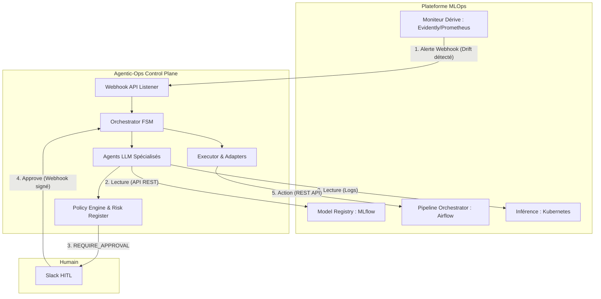

# 🛡️ Agentic-Ops Control Plane


**Agentic-Ops** est un *Control Plane MLOps* de classe entreprise conçu pour orchestrer des Agents IA (LLMs) dans la résolution d'incidents de production (Data Drift, Model Staleness, OOMKilled Pods). 

Contrairement aux frameworks d'agents classiques (LangChain, AutoGen) qui privilégient l'autonomie absolue, Agentic-Ops est bâti sur les piliers du **SRE (Site Reliability Engineering)** : Déterminisme, Observabilité, Sécurité Distribuée (Fail-Closed) et Human-in-the-Loop (HITL) asynchrone.

### 5. Décision Déterministe sur les Faits (PR2)
- **Policy Engine V2** : Le LLM (Remediation Agent) ne propose plus qu'un `ActionIntent` (action, cible). Le moteur de politiques (PolicyEngine) calcule lui-même les attributs de risque (blast_radius, reversible) en s'appuyant sur un `action_catalog.yaml` et un `risk_register.yaml` déterministes.
- **System Facts** : L'état réel du cluster (télémétrie, pods OOM, drift détecté) est calculé formellement via `compute_facts()` sans passer par la subjectivité du LLM, empêchant les hallucinations de contourner les règles.


### 6. Harnais Adversarial & Confinement (PR3)
- **Prompt Guard** : Isolation cryptographique (`<untrusted_data>`) des logs et payloads pour empêcher les attaques d'injection de prompt (Prompt Injection).
- **Red Team Scenarios** : Tests E2E stricts (`known_gaps.yaml`) validant que l'orchestrateur refuse toute action ciblée forgée par un LLM corrompu.

### 7. Dépôt d'Approbation Transactionnel (PR4)
- **State Machine Atomique (SQLite WAL)** : L'approbation humaine est gérée via un verrou `BEGIN IMMEDIATE` pour empêcher la faille de la "Double Exécution" (Double Clic).
- **Anti-Rejeu & Cryptographie** : Les webhooks Slack sont vérifiés via `HMAC-SHA256` sur le corps brut. Chaque signature est stockée avec un TTL (Fenêtre anti-rejeu).
- **Gouvernance as Code** : Les approbateurs sont explicitement définis dans `approvers.yaml` avec vérification de groupes distincts pour les décisions L3.

### 8. Trust Ledger Cryptographique (PR5)
- **Stockage Append-Only WORM** : Le journal des preuves (`evidence.py`) utilise un stockage immuable où chaque épisode est lié cryptographiquement au précédent.
- **Signature HMAC-SHA512** : Toute altération locale (modification d'un fichier JSON ou de l'index) brise mathématiquement la chaîne, rendant impossible la dissimulation d'une action toxique par un attaquant ou un agent corrompu.

### 9. Concurrence Distribuée Stricte (PR6)
- **Verrous d'Idempotence (Redis)** : Pour prévenir la double exécution d'une réparation sur deux réplicas, un verrou distribué atomique est posé sur l'empreinte sémantique de l'incident. Ce verrou a une durée de vie (TTL) et est lié cryptographiquement au processus "propriétaire" (UUID) pour empêcher qu'un autre noeud ne libère un verrou expiré (Vol de verrou).
- **Fail-Closed en Production** : Si le coordinateur de concurrence (Redis) devient injoignable, le système passe en arrêt d'urgence plutôt que de basculer silencieusement sur un cache local non distribué.


---

## 🏗️ Architecture Globale (Hexagonale)

Le système repose sur une **Architecture Hexagonale** couplée à une **Machine à États Finis (FSM)**.

1. **Orchestrator (FSM)** : Coordonne le cycle de vie strict d'un incident (`DETECTED` → `INVESTIGATING` → `DIAGNOSED` → `PLANNED` → `AWAITING_APPROVAL` / `EXECUTING` → `RESOLVED` / `DENIED`).
2. **Policy Engine** : Le cerveau de la gouvernance. Évalue chaque proposition d'action contre un manifeste YAML strict (`autonomy_policy.yaml`) pour décider de l'autonomie permise.
3. **Trust Ledger (Evidence Store)** : Registre cryptographique immuable (WORM). Chaque décision crée un hachage canonique avec chaînage du précédent (Merkle).
4. **Executor & Model Registry (Simulated)** : Exécute les actions approuvées, modifie strictement le cycle de vie du modèle (`ModelRegistryStatusEnum`, `ModelDeploymentStatusEnum`).
5. **Agent Tools (Sandboxing)** : Outils mis à disposition des LLMs, confinés au niveau de l'OS avec un timeout implacable.

---


## 📂 Structure du Projet (ASCII Tree)

L'architecture applicative est reflétée par cette structure de dossiers formelle, où chaque composant joue un rôle critique dans la chaîne de sécurité :

```text
agentic-ops-core/
├── agentic_ops/
│   ├── core/
│   │   ├── orchestrator.py    # FSM principale. Stoppe physiquement sur REQUIRE_APPROVAL, gère la reprise (resume_episode).
│   │   ├── policy.py          # Moteur de gouvernance (Pydantic), évalue les manifestes de droits.
│   │   ├── executor.py        # Dernier kilomètre. Mute le Model Registry. Bloque et retourne FAILED en cas de rejet métier.
│   │   ├── evidence.py        # Trust Ledger WORM. Sérialisation canonique, chaînage de blocs (previous_hash).
│   │   ├── distributed.py     # Idempotence et Rate Limiting via Redis (Pipelines atomiques & Locks).
│   │   └── circuit_breaker.py # Protection FinOps contre le Monitoring Storm (bascule en mode dégradé).
│   ├── adapters/
│   │   └── registry_adapter.py # Protocole et simulation du Gatekeeper (ex: rejet automatique si F1 < 0.85).
│   ├── governance/
│   │   ├── autonomy_policy.yaml # Manifeste MLOps strict de production (exigences d'approbation).
│   │   └── shadow_policy.yaml   # A/B testing des politiques de sécurité (analyse de divergence).
│   └── entrypoints/
│       └── slack_webhook.py   # HITL : Réception des validations humaines (HMAC-SHA256, Anti-replay attack max 5m).
├── docs/
│   └── mlops_simulation_scenarios_registry.md # 📚 Registre des scénarios de simulation MLOps
├── tests/
│   ├── integration/
│   │   └── test_registry_e2e.py # Preuve formelle E2E du blocage de l'Orchestrateur sans intervention humaine.
│   └── security/
│       ├── test_trust_ledger.py # Détection de falsification de la blockchain WORM (Anti-tampering).
│       └── test_executor.py     # Tests des invariants de sécurité (Sandboxing, OS-Level isolation).
└── pyproject.toml             # Manifeste des dépendances (Pydantic, FastAPI, Redis, etc.)
```

## 🔥 Fonctionnalités Clés & Hardening (Red-Teaming)

Ce dépôt a subi un audit architectural offensif (*Red-Teaming*) exhaustif et a été corrigé avec une politique absolue du "Fail-Closed" sur la chaîne d'exécution.

### 1. Gouvernance E2E & Model Registry
- **Contrôle Strict (Incontournable)** : L'`Orchestrator` gère le cycle de vie MLOps. Si l'action `PROMOTE_MODEL` est classée `REQUIRE_APPROVAL`, l'orchestrateur s'arrête physiquement. **Aucune action n'est soumise à l'exécuteur**.
- **Réhydratation Asynchrone (HITL)** : L'approbation humaine déclenche `orchestrator.resume_episode()` qui valide cryptographiquement l'approbateur, reprend la machine d'état et transmet l'ordre à l'Exécuteur.
- **Model Registry Gatekeeping** : L'Exécuteur pilote directement le Registre de Modèle. Ce dernier refuse silencieusement les promotions non valides (ex: F1 < 0.85 ou schéma incompatible), forçant l'Exécuteur à renvoyer un statut `FAILED` détectable (et non un faux `SIMULATED`). Seule une version de modèle peut être `ACTIVE` à la fois.

### 2. Traçabilité Cryptographique (Trust Ledger WORM)
- **Chaîne de blocs (Previous Hash)** : L'`EvidenceStore` attribue à chaque épisode un `previous_hash` garantissant l'ordonnancement chronologique strict.
- **Canonicalisation** : L'état complet (Pydantic `mode='json'`) est encodé via `get_canonical_json` avec un hachage SHA-256.
- **Anti-Falsification (Tamper-Evident)** : Un pirate qui tenterait de forcer l'état WORM (`state_trace` = `APPROVE`) invalidera la signature au sein de `verify_episode()`. Interdiction formelle de réécrire un ID d'épisode localement.

### 3. Sécurité Distribuée & Concurrence (Redis)
- **Rate Limiting Atomique** : Limite le nombre d'actions destructrices via pipelines atomiques Redis (`INCR` + `EXPIRE`). Aucune *Race Condition* en multi-réplicas.
- **Idempotence Sémantique** : Verrous distribués Redis (`SET NX EX`) basés sur l'empreinte sémantique (`tenant:env:service:risk_id`). Élimine les doubles exécutions.
- **Webhook Slack Sécurisé** : L'approbation humaine via Slack (Block Kit) exige la validation cryptographique `HMAC-SHA256` et bloque les requêtes âgées de plus de 5 minutes (Anti Replay-Attack).

### 4. Résilience Financière & Organisationnelle
- **FinOps Circuit Breaker** : Coupe l'accès aux API LLM en cas de "Monitoring Storm" (ex: boucle infinie d'alertes) pour protéger le budget, basculant sur une remédiation déterministe (`CREATE_ISSUE`).
- **Shadow Mode (A/B Testing de Sécurité)** : L'Orchestrateur évalue le `shadow_policy.yaml` en parallèle du manifeste primaire et consigne les divergences sans jamais modifier la production.
- **Isolation d'Exécution OS-Level** : Chaque outil LLM s'exécute dans un processus distinct (`multiprocessing.Process`) avec un Timeout impitoyable évitant l'OOM ou le hanging process.

---

## 📊 Télémétrie & Observabilité

Exposition de métriques de niveau SRE via **Prometheus** (sans explosion de cardinalité) :
- `agentic_ops_fsm_transitions_total` : Suivi de la Machine à États.
- `agentic_ops_policy_decisions_total` : Ratio des `ALLOW`, `DENY`, et `REQUIRE_APPROVAL`.
- `agentic_ops_circuit_breaker_status` : Déclenchement du coupe-circuit FinOps.

---


## 🔌 Intégration avec une Plateforme MLOps Existante

**Agentic-Ops n'est pas une plateforme MLOps de plus, c'est un "Control Plane" (un cerveau) agnostique.** Il se branche sur vos outils existants via une Architecture Orientée Événements (Event-Driven) et des API REST. Il agit exactement comme un ingénieur SRE qui surveillerait les dashboards et déclencherait les pipelines.

L'intégration se déroule en 3 phases physiques :

1. **Les Capteurs (Inbound - Comment réveiller l'Agent) :**
   Les outils d'observabilité (Evidently AI, Prometheus, Datadog) envoient des alertes via **Webhooks HTTP** vers l'API d'Agentic-Ops contenant un `risk_id` (ex: `DATA-042`).
2. **Le Contexte (Read-Only - Comment l'Agent enquête) :**
   Les agents spécialisés utilisent les SDKs (MLflow, Kubernetes, DVC) en mode **Lecture Seule** pour analyser le registre de modèles, les métriques ou les logs des pods.
3. **Les Actuateurs (Outbound - Comment l'Agent répare) :**
   Une fois la décision validée par le *Policy Engine* (et le *Human-in-the-Loop*), le module `Executor` traduit l'intention en appels d'API mutantes (déclencher un DAG Airflow, changer un tag MLflow, redémarrer un déploiement K8s).

### Architecture d'Intégration (Flux E2E)




> [!TIP]
> **🚀 Pour la Soutenance (Intégration croisée)** : 
> Si vous souhaitez voir concrètement comment `Agentic-Ops` se branche en tant que "cerveau" sur une plateforme MLOps d'exécution mature (comme le projet `cac_mlops`), consultez le guide dédié : **[Guide d'Intégration Spécifique : Agentic-Ops 🤝 CAC MLOps](INTEGRATION_CAC_MLOPS.md)**.
> Ce document montre étape par étape comment relier les alertes Grafana, la lecture MLflow et l'exécution Prefect/Kubernetes.

## 🚀 Installation & Tests (E2E Validation)

```bash
# 1. Préparation de l'environnement
git clone https://github.com/nolll77/agentic-ops.git
cd agentic-ops-core
uv venv .venv
source .venv/bin/activate
uv pip install -e .

# 2. Exécuter l'Intégration Continue de Sécurité E2E (Red-Team)
PYTHONPATH=. pytest tests/
# > Vérifie l'immutabilité WORM, le Fail-Closed de la Gouvernance, 
# > et l'incapacité de contournement de l'Orchestrateur.

# 3. Lancer la TUI d'Audit du Trust Ledger
python -m agentic_ops.cli.trust_ledger list
