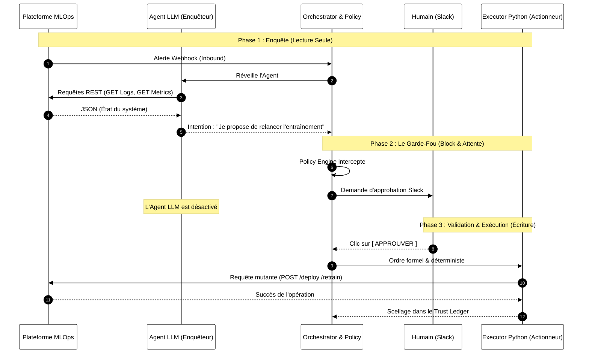
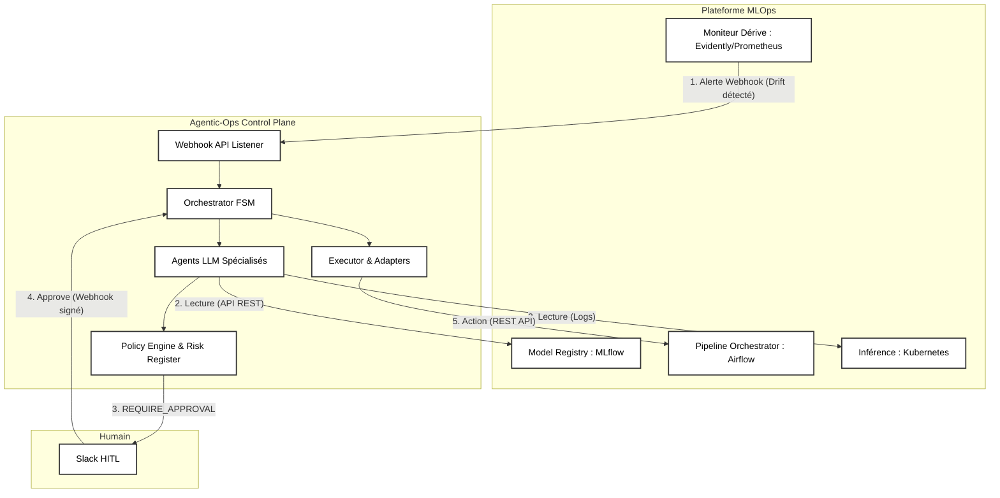

# 🛡️ Agentic-Ops Control Plane


**Agentic-Ops** est un *Control Plane MLOps* de classe entreprise conçu pour orchestrer des Agents IA (LLMs) dans la résolution d'incidents de production (Data Drift, Model Staleness, OOMKilled Pods). 

Contrairement aux frameworks d'agents classiques (LangChain, AutoGen) qui privilégient l'autonomie absolue, Agentic-Ops est bâti sur les piliers du **SRE (Site Reliability Engineering)** : Déterminisme, Observabilité, Sécurité Distribuée (Fail-Closed) et Human-in-the-Loop (HITL) asynchrone.

> **Validation Cloud et Deploiement Sandbox** : Pour consulter le rapport officiel de déploiement en conditions réelles et l'interprétation exhaustive ligne par ligne des 30 tests de sécurité exécutés sur micro-VM isolée (Docker Agentic Platform), consultez :  
> 👉 **[Rapport de Déploiement & Validation Cloud Sandbox (Docker)](DOCKER_SANDBOX_VALIDATION.md)**.


### 5. Décision Déterministe sur les Faits (PR2)
- **Policy Engine V2** : Le LLM (Remediation Agent) ne propose plus qu'un `ActionIntent` (action, cible). Le moteur de politiques (PolicyEngine) calcule lui-même les attributs de risque (blast_radius, reversible) en s'appuyant sur un `action_catalog.yaml` et un `risk_register.yaml` déterministes.
- **System Facts** : L'état réel du cluster (télémétrie, pods OOM, drift détecté) est calculé formellement via `compute_facts()` sans passer par la subjectivité du LLM, empêchant les hallucinations de contourner les règles.


### 6. Harnais Adversarial & Confinement (PR3)
- **Prompt Guard** : Isolation cryptographique (`<untrusted_data>`) des logs et payloads pour empêcher les attaques d'injection de prompt (Prompt Injection).
- **Red Team Scenarios** : Tests E2E stricts (`known_gaps.yaml`) validant que l'orchestrateur refuse toute action ciblée forgée par un LLM corrompu.

### 7. Dépôt d'Approbation Transactionnel (PR4)
- **State Machine Atomique (SQLite WAL)** : L'approbation humaine est gérée via un verrou `BEGIN IMMEDIATE` pour empêcher la faille de la "Double Exécution" (Double Clic).
- **Anti-Rejeu & Cryptographie** : Les webhooks Slack sont vérifiés via `HMAC-SHA256` sur le corps brut. Chaque signature est stockée avec un TTL (Fenêtre anti-rejeu).
- **Gouvernance as Code** : Les approbateurs sont explicitement définis dans `approvers.yaml` avec vérification de groupes distincts pour les décisions L3.

### 8. Trust Ledger Cryptographique (PR5)
- **Stockage Append-Only WORM** : Le journal des preuves (`evidence.py`) utilise un stockage immuable où chaque épisode est lié cryptographiquement au précédent.
- **Signature HMAC-SHA512** : Toute altération locale (modification d'un fichier JSON ou de l'index) brise mathématiquement la chaîne, rendant impossible la dissimulation d'une action toxique par un attaquant ou un agent corrompu.

### 9. Concurrence Distribuée Stricte (PR6)
- **Verrous d'Idempotence (Redis)** : Pour prévenir la double exécution d'une réparation sur deux réplicas, un verrou distribué atomique est posé sur l'empreinte sémantique de l'incident. Ce verrou a une durée de vie (TTL) et est lié cryptographiquement au processus "propriétaire" (UUID) pour empêcher qu'un autre noeud ne libère un verrou expiré (Vol de verrou).
- **Fail-Closed en Production** : Si le coordinateur de concurrence (Redis) devient injoignable, le système passe en arrêt d'urgence plutôt que de basculer silencieusement sur un cache local non distribué.

### 10. Durcissement Opérationnel & CI/CD (PR7)
- **RBAC Kubernetes Restreint** : Le ServiceAccount Kubernetes du Control Plane fonctionne selon le principe du moindre privilège. Il a uniquement les droits `get/list/watch` sur les Pods (pour la lecture des logs) et `patch` sur les Deployments (uniquement pour forcer le redémarrage d'un modèle fautif).
- **Fiabilité Kubernetes (Probes)** : Le Chart Helm intègre des `livenessProbe` et `readinessProbe` pointant vers une API FastAPI native pour assurer que le pod est sain et prêt à recevoir le trafic Slack Webhook.
- **Dépendances & CI Matrix** : L'environnement Python est déterministe avec une matrice de test GitHub Actions sur Python 3.10, 3.11, et 3.12, validant le comportement sur toutes les cibles modernes. L'image Docker est fixée par tag.


---

## 🏗️ Architecture Globale (Hexagonale)

Le système repose sur une **Architecture Hexagonale** couplée à une **Machine à États Finis (FSM)**.

1. **Orchestrator (FSM)** : Coordonne le cycle de vie strict d'un incident (`DETECTED` → `INVESTIGATING` → `DIAGNOSED` → `PLANNED` → `AWAITING_APPROVAL` / `EXECUTING` → `RESOLVED` / `DENIED`).
2. **Policy Engine** : Le cerveau de la gouvernance. Évalue chaque proposition d'action contre un manifeste YAML strict (`autonomy_policy.yaml`) pour décider de l'autonomie permise.
3. **Trust Ledger (Evidence Store)** : Registre cryptographique immuable (WORM). Chaque décision crée un hachage canonique avec chaînage du précédent (Merkle).
4. **Executor & Model Registry (Simulated)** : Exécute les actions approuvées, modifie strictement le cycle de vie du modèle (`ModelRegistryStatusEnum`, `ModelDeploymentStatusEnum`).
5. **Agent Tools (Sandboxing)** : Outils mis à disposition des LLMs, confinés au niveau de l'OS avec un timeout implacable.

---


## 📂 Structure du Projet (ASCII Tree)

L'architecture applicative est reflétée par cette structure de dossiers formelle, où chaque composant joue un rôle critique dans la chaîne de sécurité :

```text
agentic-ops-core/
├── agentic_ops/
│   ├── core/
│   │   ├── orchestrator.py    # FSM principale. Stoppe physiquement sur REQUIRE_APPROVAL, gère la reprise (resume_episode).
│   │   ├── policy.py          # Moteur de gouvernance (Pydantic), évalue les manifestes de droits.
│   │   ├── executor.py        # Dernier kilomètre. Mute le Model Registry. Bloque et retourne FAILED en cas de rejet métier.
│   │   ├── evidence.py        # Trust Ledger WORM. Sérialisation canonique, chaînage de blocs (previous_hash).
│   │   ├── distributed.py     # Idempotence et Rate Limiting via Redis (Pipelines atomiques & Locks).
│   │   └── circuit_breaker.py # Protection FinOps contre le Monitoring Storm (bascule en mode dégradé).
│   ├── adapters/
│   │   └── registry_adapter.py # Protocole et simulation du Gatekeeper (ex: rejet automatique si F1 < 0.85).
│   ├── governance/
│   │   ├── autonomy_policy.yaml # Manifeste MLOps strict de production (exigences d'approbation).
│   │   └── shadow_policy.yaml   # A/B testing des politiques de sécurité (analyse de divergence).
│   └── entrypoints/
│       └── slack_webhook.py   # HITL : Réception des validations humaines (HMAC-SHA256, Anti-replay attack max 5m).
├── docs/
│   └── mlops_simulation_scenarios_registry.md # 📚 Registre des scénarios de simulation MLOps
├── tests/
│   ├── integration/
│   │   └── test_registry_e2e.py # Preuve formelle E2E du blocage de l'Orchestrateur sans intervention humaine.
│   └── security/
│       ├── test_trust_ledger.py # Détection de falsification de la blockchain WORM (Anti-tampering).
│       └── test_executor.py     # Tests des invariants de sécurité (Sandboxing, OS-Level isolation).
└── pyproject.toml             # Manifeste des dépendances (Pydantic, FastAPI, Redis, etc.)
```

## 🔥 Fonctionnalités Clés & Hardening (Red-Teaming)

Ce dépôt a subi un audit architectural offensif (*Red-Teaming*) exhaustif et a été corrigé avec une politique absolue du "Fail-Closed" sur la chaîne d'exécution.

### 1. Gouvernance E2E & Model Registry
- **Contrôle Strict (Incontournable)** : L'`Orchestrator` gère le cycle de vie MLOps. Si l'action `PROMOTE_MODEL` est classée `REQUIRE_APPROVAL`, l'orchestrateur s'arrête physiquement. **Aucune action n'est soumise à l'exécuteur**.
- **Réhydratation Asynchrone (HITL)** : L'approbation humaine déclenche `orchestrator.resume_episode()` qui valide cryptographiquement l'approbateur, reprend la machine d'état et transmet l'ordre à l'Exécuteur.
- **Model Registry Gatekeeping** : L'Exécuteur pilote directement le Registre de Modèle. Ce dernier refuse silencieusement les promotions non valides (ex: F1 < 0.85 ou schéma incompatible), forçant l'Exécuteur à renvoyer un statut `FAILED` détectable (et non un faux `SIMULATED`). Seule une version de modèle peut être `ACTIVE` à la fois.

### 2. Traçabilité Cryptographique (Trust Ledger WORM)
- **Chaîne de blocs (Previous Hash)** : L'`EvidenceStore` attribue à chaque épisode un `previous_hash` garantissant l'ordonnancement chronologique strict.
- **Canonicalisation** : L'état complet (Pydantic `mode='json'`) est encodé via `get_canonical_json` avec un hachage SHA-256.
- **Anti-Falsification (Tamper-Evident)** : Un pirate qui tenterait de forcer l'état WORM (`state_trace` = `APPROVE`) invalidera la signature au sein de `verify_episode()`. Interdiction formelle de réécrire un ID d'épisode localement.

### 3. Sécurité Distribuée & Concurrence (Redis)
- **Rate Limiting Atomique** : Limite le nombre d'actions destructrices via pipelines atomiques Redis (`INCR` + `EXPIRE`). Aucune *Race Condition* en multi-réplicas.
- **Idempotence Sémantique** : Verrous distribués Redis (`SET NX EX`) basés sur l'empreinte sémantique (`tenant:env:service:risk_id`). Élimine les doubles exécutions.
- **Webhook Slack Sécurisé** : L'approbation humaine via Slack (Block Kit) exige la validation cryptographique `HMAC-SHA256` et bloque les requêtes âgées de plus de 5 minutes (Anti Replay-Attack).

### 4. Résilience Financière & Organisationnelle
- **FinOps Circuit Breaker** : Coupe l'accès aux API LLM en cas de "Monitoring Storm" (ex: boucle infinie d'alertes) pour protéger le budget, basculant sur une remédiation déterministe (`CREATE_ISSUE`).
- **Shadow Mode (A/B Testing de Sécurité)** : L'Orchestrateur évalue le `shadow_policy.yaml` en parallèle du manifeste primaire et consigne les divergences sans jamais modifier la production.
- **Isolation d'Exécution OS-Level** : Chaque outil LLM s'exécute dans un processus distinct (`multiprocessing.Process`) avec un Timeout impitoyable évitant l'OOM ou le hanging process.

---

## 📊 Télémétrie & Observabilité

Exposition de métriques de niveau SRE via **Prometheus** (sans explosion de cardinalité) :
- `agentic_ops_fsm_transitions_total` : Suivi de la Machine à États.
- `agentic_ops_policy_decisions_total` : Ratio des `ALLOW`, `DENY`, et `REQUIRE_APPROVAL`.
- `agentic_ops_circuit_breaker_status` : Déclenchement du coupe-circuit FinOps.

---


### 4. Séparation des Pouvoirs (Isolation Cognitive vs Exécutive)

L'une des vulnérabilités majeures des frameworks d'agents autonomes classiques est de donner les "clés du réseau" à l'IA. Agentic-Ops résout ce problème par une séparation stricte des privilèges :

- **Phase d'Enquête (L'IA lit) :** Les agents LLM ont un accès **strictement restreint à la lecture seule** (Mode Pull). Ils interrogent les bases de métriques et les logs pour poser un diagnostic. Ils sont physiquement incapables d'altérer la production. Ils se contentent de rédiger une "intention de modification" textuelle.
- **Phase d'Exécution (Le Code écrit) :** L'agent IA s'arrête. C'est le programme Python rigide (l'Exécuteur), totalement déterministe, qui prend le relais **uniquement** après l'approbation humaine. C'est lui, et lui seul, qui détient les clés API et qui déclenche les mutations (Mode Push).




## 🔌 Intégration avec une Plateforme MLOps Existante

**Agentic-Ops n'est pas une plateforme MLOps de plus, c'est un "Control Plane" (un cerveau) agnostique.** Il se branche sur vos outils existants via une Architecture Orientée Événements (Event-Driven) et des API REST. Il agit exactement comme un ingénieur SRE qui surveillerait les dashboards et déclencherait les pipelines.

L'intégration se déroule en 3 phases physiques :

1. **Les Capteurs (Inbound - Comment réveiller l'Agent) :**
   Les outils d'observabilité (Evidently AI, Prometheus, Datadog) envoient des alertes via **Webhooks HTTP** vers l'API d'Agentic-Ops contenant un `risk_id` (ex: `DATA-042`).
2. **Le Contexte (Read-Only - Comment l'Agent enquête) :**
   Les agents spécialisés utilisent les SDKs (MLflow, Kubernetes, DVC) en mode **Lecture Seule** pour analyser le registre de modèles, les métriques ou les logs des pods.
3. **Les Actuateurs (Outbound - Comment l'Agent répare) :**
   Une fois la décision validée par le *Policy Engine* (et le *Human-in-the-Loop*), le module `Executor` traduit l'intention en appels d'API mutantes (déclencher un DAG Airflow, changer un tag MLflow, redémarrer un déploiement K8s).

### Architecture d'Intégration (Flux E2E)




> [!TIP]
> **🚀 Pour la Soutenance (Intégration croisée)** : 
> Si vous souhaitez voir concrètement comment `Agentic-Ops` se branche en tant que "cerveau" sur une plateforme MLOps d'exécution mature (comme un projet cible), consultez le guide dédié : **[Guide d'Intégration Spécifique : Agentic-Ops 🤝 Plateforme Cible](INTEGRATION_GUIDE.md)**.
> Ce document montre étape par étape comment relier les alertes Grafana, la lecture MLflow et l'exécution Prefect/Kubernetes.


### Liste des Actions Physiques (Pouvoirs de Mutation)

Le module d'exécution (`Executor`) est le seul composant autorisé à réaliser des écritures. Ces actions sont strictement soumises à la désactivation du mode simulation (`SIMULATION_MODE=False`) et à l'approbation humaine (si requise par la politique).

#### 1. Intégration Code & Audit (API GitHub)
*Action d'alerte et de traçabilité asynchrone.*
- **Action ciblée** : `CREATE_ISSUE`
- **Mécanisme** : Forge une requête HTTP POST sécurisée avec un Token d'accès vers l'API de GitHub.
- **Résultat** : Crée instantanément un ticket de remédiation (Issue) sur le dépôt distant, taggé avec `mlops-incident`, détaillant le diagnostic de l'Agent.

#### 2. Remédiation d'Infrastructure (API Kubernetes)
*Action de protection d'urgence (Coupe-circuit).*
- **Action ciblée** : `SCALE_TO_ZERO`
- **Mécanisme** : Utilise le client officiel Python `kubernetes` pour se connecter au cluster de production et patcher le déploiement d'un pod.
- **Sécurité Fail-Closed** : L'exécuteur est bridé par une *Whitelist*. Il refusera formellement d'altérer un namespace ou un conteneur non explicitement autorisé.
- **Résultat** : Éteint totalement une API de prédiction défaillante pour stopper une hémorragie de mauvaises décisions, avec une vérification *Read-After-Write* post-exécution.

#### 3. Orchestration MLOps (API Prefect via Tunnel)
*Action de ré-entraînement.*
- **Action ciblée** : `TRIGGER_RETRAINING`
- **Mécanisme** : Cible l'infrastructure distante via le réseau superposé (ex: Tailscale) et envoie un appel formel `POST /api/deployments/{id}/create_flow_run`.
- **Résultat** : Force l'orchestrateur distant à lancer le pipeline d'ingestion de données et de réentraînement du modèle d'apprentissage automatique.

#### 4. Promotion de Modèle (API MLflow via Tunnel)
*Action de mise en production.*
- **Action ciblée** : `PROMOTE_MODEL`
- **Mécanisme** : Interagit avec l'API REST du Model Registry (`POST /api/2.0/mlflow/registered-models/alias`) via le réseau superposé.
- **Résultat** : Assigne l'alias `@Production` à un nouveau modèle candidat, déclenchant ainsi le basculement du trafic d'inférence.

#### Actions en mode "Dry-Run" (Simulées)
Certaines actions exploratoires ou à risque asymétrique sont maintenues en simulation stricte (journalisées dans le registre WORM sans exécution réseau) :
- `ROLLBACK` : Rétrograder une version d'image ou de modèle.
- `INVESTIGATE` : Consigner formellement une enquête sans altération.


## 🔌 Interfaçage Universel (Agnostic MLOps Control Plane)

**Agentic-Ops** a été pensé dès le premier jour comme un plan de contrôle agnostique. Il ne dépend pas du code source du modèle qu'il surveille. Il n'a besoin que de trois choses pour piloter une infrastructure tierce :
1. Un accès réseau sécurisé (ex: *Tailscale*).
2. Un point de terminaison pour recevoir les alertes (ex: *Webhook Grafana*).
3. Des points de terminaison pour déclencher les actions (ex: *API Prefect, MLflow, Kubernetes*).

À titre de démonstration, voici comment **Agentic-Ops** peut se greffer "Plug & Play" sur la majorité des architectures MLOps de l'écosystème **DataScientest** (sans modifier leur code source) pour leur apporter l'auto-guérison :


| N° | Projet Cible | Type & Enjeu | Écosystème MLOps | Métriques de Télémétrie | Scénario d'Auto-Guérison Agentic-Ops |
|:---|:---|:---|:---|:---|:---|
| **1** | [MultiModalAI-MLOps (Référence)](https://github.com/YBengala/MultiModalAI-MLOps) | Multimodal | `FastAPI`, `Docker`, `Prometheus`, `MLflow`, `Evidently` | F1-Score, Divergence KL, Latence API | `SCALE_UP` ➔ `INVESTIGATE_LOGS` ➔ `TRIGGER_RETRAINING` ➔ `PROMOTE_MODEL` |
| **2** | [Road Accidents BAAC (France)](https://github.com/DataScientest-Studio/oct25_bmlops_int_accidents) | Sévérité Accidents | `Evidently`, `Airflow`, `FastAPI`, `Docker`, `Grafana`, `MLflow` | *Data Drift* (Météo/Lieu), Accuracy, OOM Kills | `INVESTIGATE_LOGS` ➔ `SCALE_UP` ➔ `TRIGGER_RETRAINING` ➔ `ROLLBACK` |
| **3** | [MLOps Accidents (Liora)](https://github.com/aupaysdesdata/MLOps_accidents) | Inférence Sévérité | `BentoML`, `GitHub Actions`, `Airflow`, `Grafana` | Requêtes/sec (RPS), Latence, Faux Positifs | `SCALE_UP` ➔ `INVESTIGATE_LOGS` ➔ `CREATE_ISSUE` ➔ `NOTIFY_ONCALL` |
| **4** | [Rakuten MLOps Platform](https://github.com/DataScientest-Studio/jun25_bmle_mlops_rakuten2) | Texte/Image | `Airflow`, `DVC`, `PostgreSQL`, `MLflow`, `Docker` | F1-Score, *Data Drift*, Latence, Erreurs API | `INVESTIGATE_LOGS` ➔ `CREATE_ISSUE` ➔ `TRIGGER_RETRAINING` ➔ `PROMOTE_MODEL` |
| **5** | [Rakuten (K8s & Evidently)](https://github.com/DataScientest-Studio/jun25_bmle_mlops_rakuten1) | Déploiement K8s | `Kubernetes`, `Evidently`, `GitHub Actions`, `MLflow` | *Concept Drift*, RAM Pods, mAP, Covariate Shift | `SCALE_UP` ➔ `RESTART_PODS` ➔ `ROLLBACK` ➔ `NOTIFY_ONCALL` |
| **6** | [Rakuten Pipeline (FastAPI)](https://github.com/DataScientest-Studio/sep25_cmlops_rakuten) | Temps Réel | `FastAPI`, `Airflow`, `Grafana`, `Streamlit` | Drift Embeddings, RPS, Erreurs 4xx/5xx | `INVESTIGATE_LOGS` ➔ `CREATE_ISSUE` ➔ `TRIGGER_RETRAINING` |
| **7** | [Rakuten (Promo Avr 25)](https://github.com/DataScientest-Studio/avr25_bmlops_rakuten) | Pipeline Base | `MLflow`, `Prometheus`, `Grafana`, `Airflow` | Précision métier, Temps de réponse global | `INVESTIGATE_LOGS` ➔ `RESTART_PIPELINE` ➔ `TRIGGER_RETRAINING` |
| **8** | [Reco Films MLOps](https://github.com/DataScientest-Studio/jun25_bmle_mlops_reco_films) | Collaboratif | `Evidently`, `FastAPI`, `DVC`, `Airflow`, `MLflow` | CTR, Score Diversité, *Feature Drift*, Latence | `SCALE_UP` ➔ `INVESTIGATE_LOGS` ➔ `TRIGGER_RETRAINING` ➔ `PROMOTE_MODEL` |
| **9** | [Reco Films (Sep 25)](https://github.com/DataScientest-Studio/sep25_cmlops_reco_films1) | Recommandation | `Airflow`, `FastAPI`, `Docker`, `Grafana`, `MLflow` | Taux Cold-Start, Temps exécution DAG | `SCALE_UP` ➔ `RESTART_PODS` ➔ `CREATE_ISSUE` |
| **10** | [Reco Films (Bootcamp)](https://github.com/DataScientest-Studio/sep25_bmle_mlops_reco_films) | Registre Modèles | `DVC`, `MLflow`, `Docker`, `FastAPI`, `Streamlit` | MAE/RMSE, CPU Throttling, *Data Drift* | `INVESTIGATE_LOGS` ➔ `ROLLBACK` ➔ `NOTIFY_ONCALL` |
| **11** | [Australian Weather (2026)](https://github.com/DataScientest-Studio/jul26_bmlops_int_weather) | Séries Spatiales | `Nginx`, `FastAPI`, `Airflow`, `MLflow`, `DVC` | *Covariate Shift* (Pluie), MAE, CPU Nginx | `INVESTIGATE_LOGS` ➔ `RESTART_PIPELINE` ➔ `NOTIFY_ONCALL` |
| **12** | [Rain in Australia (Oct 25)](https://github.com/DataScientest-Studio/oct25_bmlops_int_weather) | Régression | `Docker`, `FastAPI`, `MLflow`, `Streamlit` | Précision, Recall, Biais saisonnier, Valeurs nulles | `CREATE_ISSUE` ➔ `TRIGGER_RETRAINING` ➔ `PROMOTE_MODEL` |
| **13** | [London Fire Brigade](https://github.com/DataScientest-Studio/juin23_continu_mlops_pompiers) | Temps Inter. | `Airflow`, `Docker`, `Streamlit`, `FastAPI` | RMSE, Temps inférence, Taux erreurs API | `INVESTIGATE_LOGS` ➔ `RESTART_PODS` ➔ `TRIGGER_RETRAINING` |
| **14** | [Plant Reco (Maladies)](https://github.com/DataScientest-Studio/sep26_bmlops_int_plant_reco) | Computer Vision | `FastAPI`, `Docker`, `MLflow`, `GitHub Actions` | Faux Négatifs (Critique), Latence Image, GPU OOM | `SCALE_UP` ➔ `ROLLBACK` ➔ `CREATE_ISSUE` |
| **15** | [Maintenance Préventive](https://github.com/yann112/mlops_project_2022_preventive_maintenance) | Classif. IoT | `FastAPI`, `Docker`, `Airflow`, `Prometheus` | *Concept Drift* (Usure), Latence, Capteurs HS | `SCALE_TO_ZERO` (Coupe-circuit) ➔ `INVESTIGATE_LOGS` |

### 🤖 Que font concrètement les agents ? (Glossaire des Actions)
Afin de transformer un simple tableau de bord passif en un véritable **Control Plane Auto-Réparateur**, le module `executor.py` d'Agentic-Ops traduit chaque décision de l'agent cognitif en appels d'API physiques vers l'infrastructure cible :

- `INVESTIGATE_LOGS` : L'agent récupère de manière autonome les logs du conteneur défaillant (ex: `kubectl logs`) et utilise son LLM pour générer un résumé de la cause racine (*Root Cause Analysis*) sans intervention humaine.
- `CREATE_ISSUE` : Génération d'un ticket formaté (GitHub/Jira/GitLab) contenant le contexte de l'incident, les métriques déviantes, et une recommandation de correctif ou d'ajustement des hyperparamètres.
- `SCALE_UP` / `SCALE_TO_ZERO` : Interaction directe avec le plan de contrôle de l'infrastructure (Kubernetes HPA, AWS ASG, API Docker) pour allouer de la puissance de calcul face à un pic de requêtes, ou couper un service qui génère des prédictions dangereuses (mode coupe-circuit).
- `TRIGGER_RETRAINING` : Appel asynchrone à un orchestrateur de pipelines (Airflow, Prefect, GitHub Actions) avec les bonnes balises temporelles pour forcer un ré-entraînement du modèle sur des données fraîches.
- `PROMOTE_MODEL` : Une fois le ré-entraînement validé, l'agent déplace le nouveau modèle du statut "Staging" à "Production" dans le *Model Registry* (MLflow, wandb) pour amorcer son déploiement.
- `RESTART_PIPELINE` / `RESTART_PODS` : Redémarrage brutal (hard-reset) d'un job de données bloqué ou d'un service d'inférence Web victime de fuite mémoire (OOM).
- `ROLLBACK` : En cas de dégradation extrême (baisse dramatique de l'accuracy suite à un nouveau modèle), l'agent bascule immédiatement le trafic vers la version `N-1`.
- `NOTIFY_ONCALL` : L'agent alerte l'ingénieur d'astreinte sur Slack/PagerDuty en lui poussant directement le contexte pré-mâché, les logs pertinents et la décision qui a été prise.

> *Cette universalité démontre la véritable valeur de l'approche **Agentic-Ops** : séparer l'intelligence cognitive et la supervision (Agentic-Ops) de la chaîne d'exécution MLOps (le projet cible).*

## 🚀 Installation & Tests (E2E Validation)

```bash
# 1. Préparation de l'environnement
git clone https://github.com/nolll77/agentic-ops.git
cd agentic-ops-core
uv venv .venv
source .venv/bin/activate
uv pip install -e .

# 2. Exécuter l'Intégration Continue de Sécurité E2E (Red-Team)
PYTHONPATH=. pytest tests/
# > Vérifie l'immutabilité WORM, le Fail-Closed de la Gouvernance, 
# > et l'incapacité de contournement de l'Orchestrateur.

# 3. Lancer la TUI d'Audit du Trust Ledger
python -m agentic_ops.cli.trust_ledger list


```

---

## Validation Cloud en Environnement Isole (Docker Agentic Platform)

Le Control Plane a été déployé, benchmarké et audité de bout en bout sur une micro-VM éphémère isolée (4 vCPUs AMD EPYC, 8 Go de RAM) au sein de la **Docker Agentic Platform** :
- **100 % des tests unitaires, cryptographiques et adversariaux validés** (`pytest`).
- **Preuve formelle de sécurité Fail-Closed** : Rejet systématique des requêtes non signées (`HTTP 401 Unauthorized`).
- **Résilience absolue face aux attaques IA** : `forbidden_executed = 0` sur l'ensemble des scénarios de simulation de crise et d'injections de prompts.

Pour consulter le protocole de démarrage complet et l'analyse ligne par ligne de la télémétrie système, référez-vous au document dédié :  
📄 **[Consulter le Rapport de Validation Cloud Sandbox (Docker)](DOCKER_SANDBOX_VALIDATION.md)**
