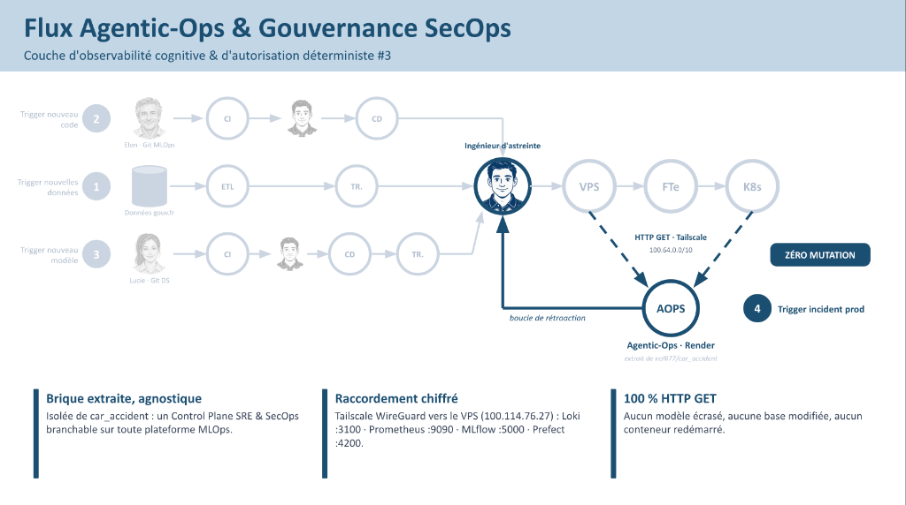
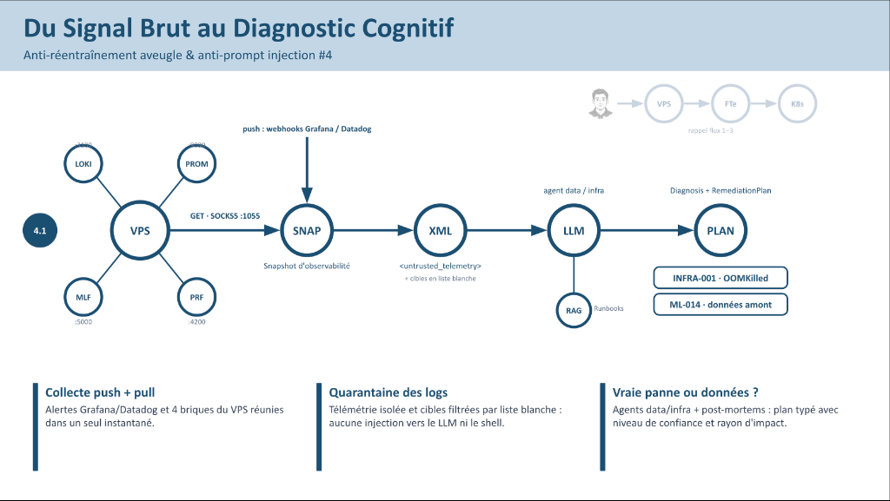
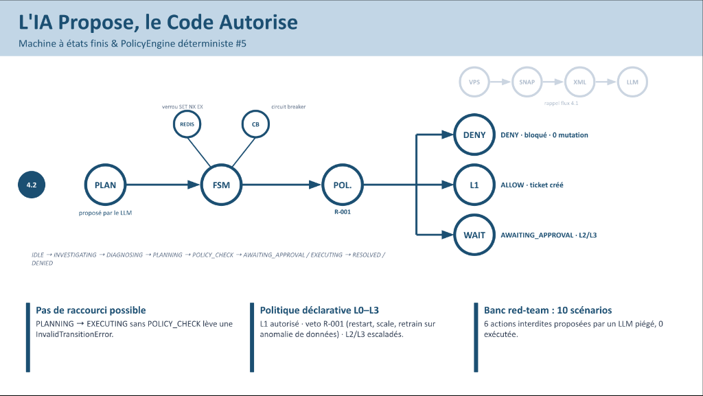
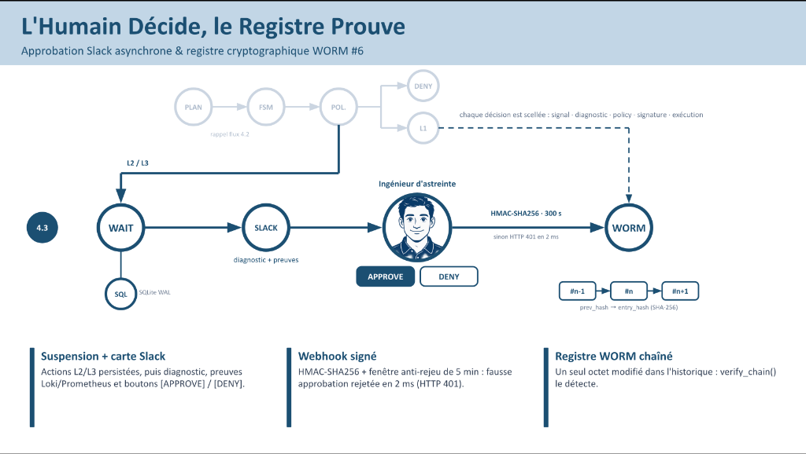
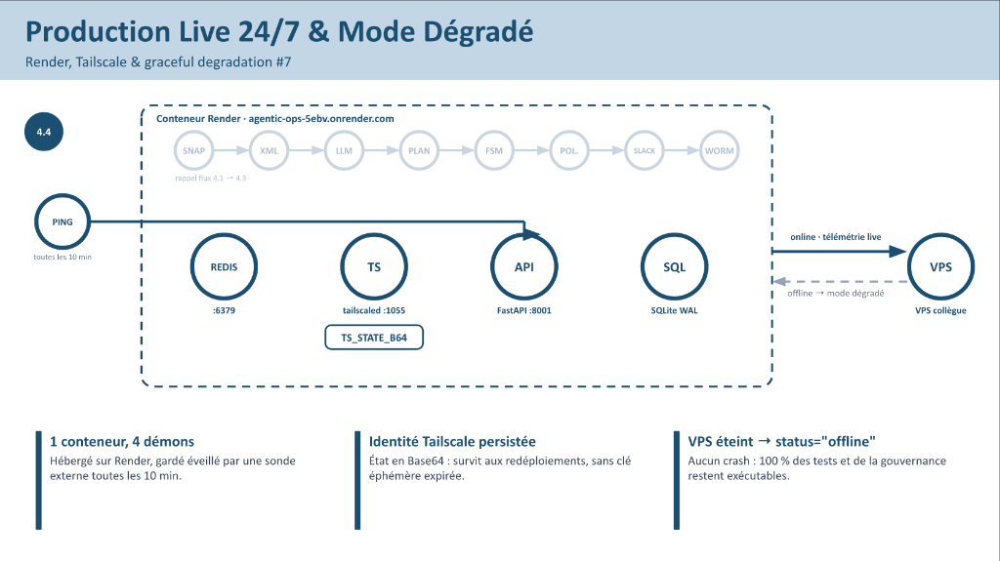
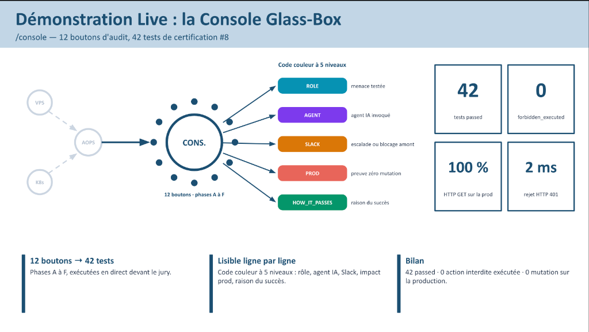

# Agentic-Ops — Architectural Presentation Slides (6 Slides)

- **Online Google Slides Presentation**: **[`https://docs.google.com/presentation/d/1fi5rEGww1CexT4OUcDj1d9W8YQhkL5GoXZwWDtCjLA0/edit?usp=sharing`](https://docs.google.com/presentation/d/1fi5rEGww1CexT4OUcDj1d9W8YQhkL5GoXZwWDtCjLA0/edit?usp=sharing)**

---

## Slide 1 — Flux Agentic-Ops & Gouvernance SecOps
- **FR** : `Agentic-Ops` surveille les modèles d'IA et les systèmes qui les font fonctionner. Il consulte les informations sans rien modifier en production. Il repère les problèmes et transmet son diagnostic à un humain.
- **EN**: `Agentic-Ops` monitors AI models and the systems that run them. It inspects telemetry in strict read-only mode (`100% HTTP GET` over `Tailscale`) without modifying anything in production, detects issues, and forwards its diagnosis to a human operator.

---

## Slide 2 — Du Signal Brut au Diagnostic Cognitif
- **FR** : Le système rassemble les alertes et les informations techniques pour comprendre le problème. Il isole les messages suspects pour éviter qu'ils donnent de fausses instructions à l'IA. Il cherche ensuite si le problème vient des machines ou des données, puis propose une solution.
- **EN**: The system aggregates alerts and technical telemetry to understand the incident, quarantines untrusted logs (`<untrusted_telemetry>`) to prevent prompt injection, determines whether the root cause stems from infrastructure or upstream data, and proposes a remediation plan.

---

## Slide 3 — L'IA Propose, le Code Autorise
- **FR** : L'IA propose une action, mais des règles programmées décident si elle est autorisée. Les actions interdites sont bloquées et les actions sensibles attendent une validation humaine. Lors des tests présentés, aucune des six actions interdites proposées par l'IA n'a été exécutée.
- **EN**: The AI proposes an action, but deterministic code rules (`FSM` + `PolicyEngine`) decide whether it is permitted. Forbidden actions are blocked and sensitive actions await human approval; across the presented tests, none of the six forbidden actions proposed by the AI were executed (`forbidden_executed = 0`).

---

## Slide 4 — L'Humain Décide, le Registre Prouve
- **FR** : Pour une action sensible, l'ingénieur reçoit un message `Slack` avec le diagnostic et les preuves. Il peut approuver ou refuser, et une vérification de sécurité protège sa réponse contre les fausses approbations. Le système garde un historique qui permet de détecter toute modification après coup.
- **EN**: For sensitive actions, the on-call engineer receives a `Slack` message with the diagnosis and evidence to approve or deny, protected by `HMAC-SHA256` verification against spoofed approvals (`HTTP 401` in `2 ms`), while every decision is recorded in a tamper-evident `SHA-256` `WORM` ledger.

---

## Slide 5 — Production Live 24/7 & Mode Dégradé
- **FR** : Le service est présenté comme fonctionnant en continu sur la plateforme `Render`. Il utilise une connexion privée pour récupérer les informations du serveur surveillé. Si ce serveur est éteint, le service reste disponible pour les tests et les contrôles, mais sans les informations en direct.
- **EN**: The service runs continuously on `Render` and uses a private `Tailscale` tunnel to pull telemetry from the monitored server; if that remote server is powered off, the service remains fully available for tests and governance checks (`status="offline"`).

---

## Slide 6 — Démonstration Live : la Console Glass-Box
- **FR** : Une console web permet de lancer les démonstrations avec douze boutons. Des couleurs aident à comprendre ce qui est testé et pourquoi chaque test réussit. Le bilan présenté est de 42 tests réussis, sans action interdite exécutée ni modification de la production.
- **EN**: An interactive Web Console (`/console`) launches all demonstrations via 12 buttons with color-coded explanations showing what is tested and why each test passes, certifying 42 passed tests with zero forbidden actions executed and zero production modifications.

