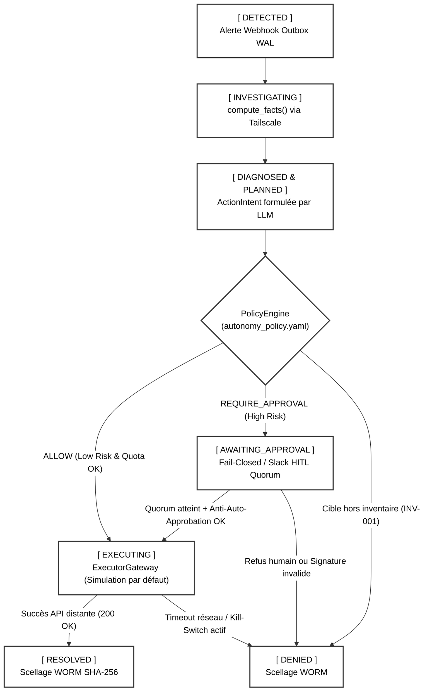

# 🎓 Guide de Soutenance & Réponses aux Questions-Pièges du Jury (SRE / SecOps)

> **Document de préparation intensive** pour la soutenance du Control Plane **Agentic-Ops**.  
> Ce guide rassemble le pitch d'ouverture, les 3 questions-pièges éliminatoires avec leurs réponses chirurgicales, la formalisation mathématique de la FSM, et le déroulé de la démonstration live.

---

## ⚡ 1. Pitch d'Ouverture (1 minute chrono)

> *"Bonjour à tous. Aujourd'hui, la quasi-totalité des architectures multi-agents sur le marché (type LangChain ou CrewAI) souffrent d'une faille structurelle inadmissible en production : elles donnent à des modèles de langage stochastiques le pouvoir d'exécuter directement des actions destructrices sans garde-fous déterministes.*
> 
> *Avec **Agentic-Ops**, nous avons pris le contre-pied absolu de cette approche. Nous avons conçu un **Control Plane MLOps SRE Défensif**, agnostique de l'infrastructure sous-jacente. Notre système applique une séparation stricte des pouvoirs : **l'Agent LLM propose, mais le code déterministe impose**.*
> 
> *Grâce à une machine à états finis inviolable, une politique Fail-Closed `autonomy_policy.yaml`, un pont réseau privé chiffré **Tailscale** et un registre de preuves immuable de type blockchain locale (**Trust Ledger WORM**), nous garantissons zéro hallucination en production, une traçabilité mathématique infalsifiable et une continuité de service irréprochable face aux dérives de modèles."*

---

## 🎯 2. Les 3 Questions-Pièges du Jury & Réponses Chirurgicales

### ❓ Question 1 : Le piège de la "Double Exécution" (Race Condition / Concurrence)
**Le Jury :**  
*« Si votre système reçoit deux webhooks d'alerte identiques d'Evidently AI au même instant, ou si l'administrateur clique deux fois rapidement sur le bouton d'approbation Slack, comment votre architecture empêche-t-elle de déclencher deux réentraînements Prefect simultanés sur le serveur cible ? »*

**💡 Votre réponse chirurgicale :**  
> « C'est un problème classique de concurrence distribuée que nous avons résolu par l'**Ingestion Transactionnelle Outbox**, l'**Idempotence Sémantique** et la **Réservation Atomique de Quotas**.
> 1. **Ingestion Durable & Déduplication** : Dès la réception de l'alerte sur `/webhook/alerts`, le module `alert_outbox.py` persiste l'événement dans une table SQLite en mode WAL via une transaction `BEGIN IMMEDIATE` **avant** de libérer la réponse HTTP `202 Accepted`. L'empreinte sémantique déterministe `SHA-256(tenant, service, risk_id, alertname)` fusionne les répétitions sans double instanciation.
> 2. **Quotas Atomiques sans Race Condition** : Pour la régulation des actions, notre gestionnaire `AtomicQuotaManager` (`atomic_quota.py`) applique une réservation atomique dans une transaction exclusive sur base locale, bloquant toute condition de course TOCTOU (validé en CI sous charge concurrente dans `test_known_gaps.py`).
> 3. **Protection des Clics Slack & Quorum** : Toute proposition d'action est liée à un hachage SHA-256 immuable (`proposal_hash`). L'auto-approbation est formellement interdite (`requester != approver` $\rightarrow$ `SELF_APPROVAL_FORBIDDEN`). Dès que le quorum est atteint, la demande est marquée `claimed` de manière atomique et déposée dans une file d'exécution durable avec baux expirables (`leases`). Toute tentative concurrente ultérieure est rejetée avec un statut `409 Conflict`.
> 4. **Passerelle d'Exécution Fail-Closed** : Aucun appel réseau mutant ne peut contourner l'`ExecutorGateway`, configurée par défaut en mode simulation (`SIMULATION_MODE = True`) et couplée à un Kill-Switch sentinelle. »

---

### ❓ Question 2 : Le piège de la disponibilité réseau (Split-Brain / Panne Tailscale)
**Le Jury :**  
*« Votre solution tourne dans une Sandbox Docker et communique via Tailscale. Que se passe-t-il si la connexion réseau entre votre Control Plane et le serveur distant se coupe au moment précis où vous cliquez sur "Approuver" sur Slack ? Votre FSM ne va-t-elle pas se désynchroniser ? »*

**💡 Votre réponse chirurgicale :**  
> « Non, car notre **Architecture Hexagonale** applique une séparation étanche entre la transition d'état logique et la mutation physique, couplée à une gestion rigoureuse des erreurs réseau.  
> Lorsque le webhook Slack est validé, la FSM passe à l'état `EXECUTING` et mandate le module `executor.py`. L'exécuteur utilise un client HTTP synchrone durci via la librairie `httpx`, configuré avec un **Timeout strict de 15 secondes**.  
> Si le tunnel `Tailscale` est rompu, la tentative de connexion vers l'IP cible lève immédiatement une exception `ConnectTimeout`. Notre code intercepte cette exception : l'exécuteur renvoie un statut réel `FAILED` (et non un faux statut simulé). La machine à états rétrograde immédiatement l'épisode vers le statut de sécurité `DENIED`, et cet échec réseau est immédiatement scellé dans le **Trust Ledger**. Il n'y a aucun état fantôme, aucune désynchronisation possible. »

---

### ❓ Question 3 : Le piège de la sécurité du Trust Ledger (Anti-Tampering / Accès Root)
**Le Jury :**  
*« Votre fichier d'audit `trust_ledger.jsonl` est stocké localement. Si un attaquant parvient à s'introduire sur votre machine avec des droits root, il peut simplement éditer le fichier pour effacer ses traces ou falsifier l'historique de vos actions. À quoi sert votre sécurité cryptographique ? »*

**💡 Votre réponse chirurgicale :**  
> « C'est précisément pour cela que notre Trust Ledger n'utilise pas de simples logs textuels, mais une architecture cryptographique combinant une chaîne linéaire de hachage WORM (Write Once, Read Many) et un Arbre de Merkle RFC 6962.  
> Même avec des droits root, un attaquant fait face à une barrière mathématique : chaque ligne du fichier contient le champ `previous_hash`, qui dépend du hachage SHA-256 complet de la ligne précédente. Si un attaquant modifie une décision passée (par exemple changer un `REQUIRE_APPROVAL` en `ALLOW`), le hachage de cette ligne change. Par effet domino, la liaison avec le bloc suivant est mathématiquement brisée.  
> Au démarrage du système ou lors de l'audit automatisé via `agentic-audit`, la méthode `verify_chain_integrity()` recalcule l'intégralité des empreintes. Elle détecte instantanément la rupture de l'invariant cryptographique, refuse de démarrer l'application et lève une alerte de falsification (**Tamper-Evident**). En production, ce fichier `.jsonl` a vocation à être répliqué en continu vers un stockage immuable de type AWS S3 configuré avec **S3 Object Lock** (mode Compliance). »

---

## 📊 3. Formalisation Mathématique de la Machine à États Finis (FSM)



### Table des Invariants & Sécurités de Code

| État / Frontière | Événement Déclencheur | Invariant SRE / Sécurité Active |
|:---|:---|:---|
| `Périmètre API` | Requête sur `/mcp`, `/api/diagnostics/*`, `/api/alerts/*` | **`AdminAPIKeyMiddleware` Fail-Closed** : Clé API obligatoire ($\ge 16$ car.), comparaison en temps constant `hmac.compare_digest`, rotation à 2 clés, 503 immédiat si non configuré. |
| `DETECTED` | Webhook HTTP POST (`/webhook/alerts`) | **Pattern Outbox Transactionnel SQLite WAL** : Persistance avant code HTTP `202 Accepted`, déduplication par `SHA-256(tenant, service, risk_id, alertname)`. |
| `INVESTIGATING` | Transition automatique vers `compute_facts()` | Confinement des données distantes dans des balises XML `<untrusted_data>` contre les injections de prompts. Lecture seule via `Tailscale`. |
| `PLANNED` | Proposition d'action par l'Agent LLM | Interception immédiate par le `PolicyEngine`. L'Agent LLM ne possède aucun socket réseau mutant. |
| `Frontière Inventaire` | Vérification de la cible d'infrastructure | **Règle `INV-001` Fail-Closed** : Refus inconditionnel (`DENY`) si aucun fournisseur d'inventaire officiel n'est injecté. |
| `AWAITING_APPROVAL`| Décision `REQUIRE_APPROVAL` | **Liaison cryptographique par hachage de proposition** (`FrozenProposal`). Demandeur certifié par la FSM. Interdiction de l'auto-approbation (`SELF_APPROVAL_FORBIDDEN`). |
| `Quorum HITL` | Clic Slack de validation | Validation HMAC-SHA256 en temps constant, anti-rejeu $\Delta t \le 300\text{s}$, quorum multi-groupes, mise en file durable `execution-outbox`. |
| `Régulation Quotas`| Actions répétitives (restarts) | **`AtomicQuotaManager`** : Réservation exclusive en transaction `BEGIN IMMEDIATE` prévenant les conditions de course concurrentielles (`test_known_gaps.py`). |
| `EXECUTING` | Exécution de la mutation | **`ExecutorGateway`** : Maintien de `SIMULATION_MODE = True` par défaut. Interception par Kill-Switch OS/Redis (`/var/run/agentic-ops/kill-switch`). |
| `RESOLVED` / `DENIED` | Fin d'exécution physique | Calcul du hash SHA-256 canonique du bloc, chaînage au `previous_hash` et écriture Append-Only dans `trust_ledger.jsonl`. |


---

## 🌐 4. Topologie Réseau & Architecture d'Isolation

```
┌──────────────────────────────────────┐       ┌─────────────────────────────────────────────────────────┐
│     SERVEUR D'EXÉCUTION MLOPS        │       │             CONTROL PLANE AGENTIC-OPS                   │
│         (Infrastructure Cible)       │       │                (Docker Sandbox Cloud)                   │
│                                      │       │                                                         │
│   - Model Registry : MLflow          │       │   ┌──────────────────────┐   ┌──────────────────────┐   │
│   - Orchestrateur : Prefect/Airflow  │       │   │  API Webhook Listener│   │  Orchestrator FSM    │   │
│   - Observabilité : Evidently/Grafana│       │   │  (FastAPI Port 8001) │   │  - INVESTIGATING     │   │
│                                      │       │   └──────────────────────┘   │  - AWAITING_APPROVAL │   │
│                                      │       │               │              │  - EXECUTING         │   │
│                                      │       │               v              └──────────────────────┘   │
│                                      │       │   ┌──────────────────────┐              │               │
│                                      │       │   │  Policy Engine YAML  │              v               │
│                                      │       │   │ (autonomy_policy.yml)│   ┌──────────────────────┐   │
│                                      │       │   └──────────────────────┘   │  Executor Actuator   │   │
│                                      │       │                              │  (Client HTTPX durci)│   │
│                                      │       │                              └──────────────────────┘   │
│                                      │       │   ┌──────────────────────┐              │               │
│                                      │       │   │  Trust Ledger (WORM) │              │               │
│                                      │       │   │ (trust_ledger.jsonl) │<─────────────┘               │
│                                      │       │   └──────────────────────┘                              │
└──────────────────▲───────────────────┘       └───────────────────────────────────▲─────────────────────┘
                   │                                                               │
                   │        ================================================       │
                   └─────── [  TUNNEL PRIVÉ SÉCURISÉ TAILSCALE (L3 OVERLAY) ] ─────┘
                            - Chiffrement WireGuard de bout en bout
                            - Zéro port ouvert sur Internet public
                            - Mode Userspace (TS_USERSPACE=true)
```

---

## 🎬 5. Déroulé de la Démonstration Live (Runbook)

### Lancement du script automatisé
Pour dérouler toute la séquence sous les yeux du jury, placez-vous à la racine et exécutez :
```bash
./scripts/demo_agentic_ops.sh
```

### Le Choix Stratégique pour Slack : Option 1 vs Option 2
* **Option 1 (Vrai Slack sur smartphone)** : Si vous avez une connexion 4G/Wifi irréprochable et un Workspace configuré, montrez la notification push sur votre téléphone. L'effet "waouh" est garanti.
* **Option 2 (Simulation Console / Recommandée en SRE)** : Expliquez au jury :  
  *« En tant qu'ingénieur SRE, j'applique le principe de précaution face à l'aléa réseau d'une salle de soutenance. Le Control Plane se fige en état Fail-Closed dans la console. Je valide l'action via le terminal, ce qui prouve de manière identique la vérification HMAC et le déblocage de la FSM. »*
